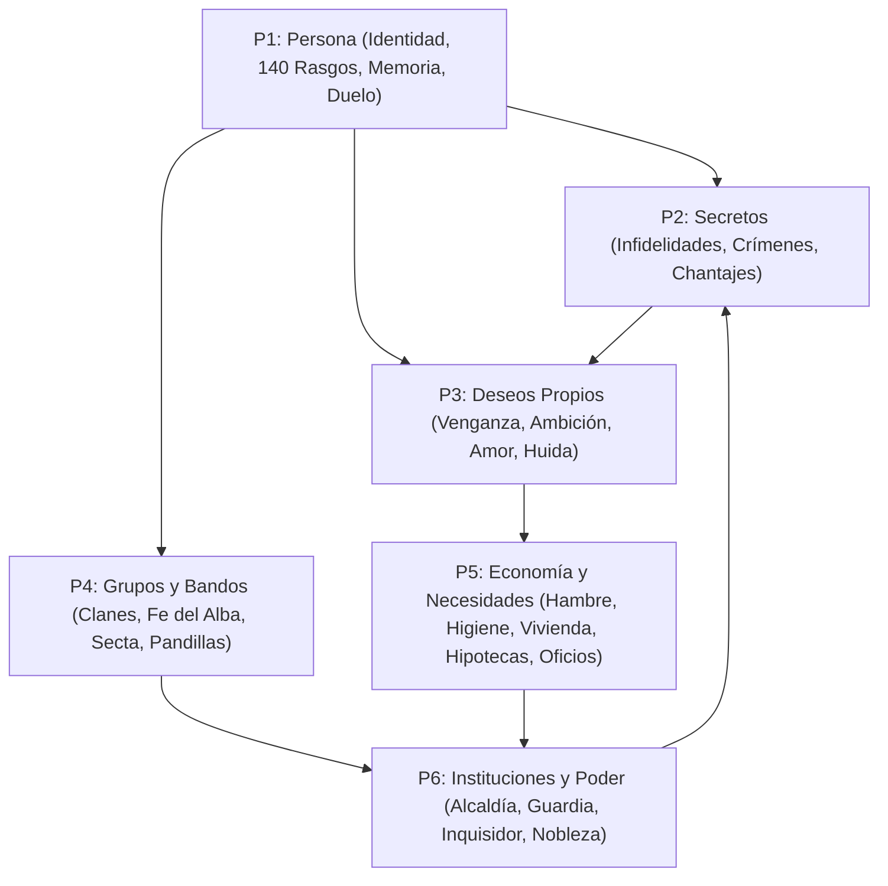
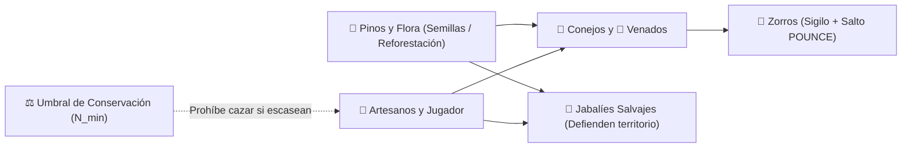
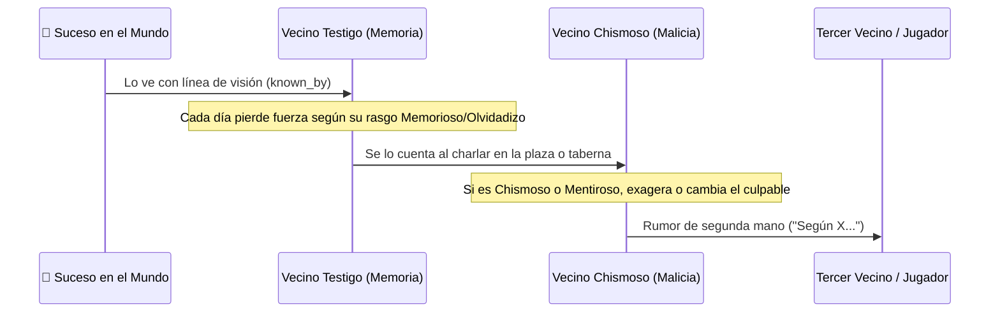
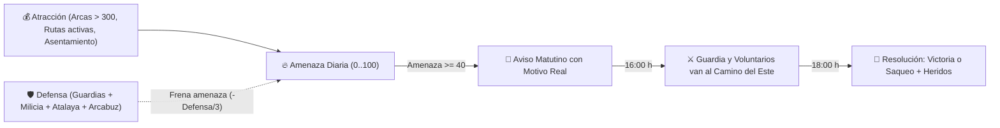

# 🧪 La Placa de Petri — Biblia Maestra del Proyecto (Día 0 → Hoy)

> [!abstract] Mapa de Contenido Principal (`#moc`)
> Este documento es el **registro integral, depurado y nativo para Obsidian** de todo lo construido, diseñado, auditado, descartado y planificado en el proyecto **[[La Placa de Petri]]** desde su primer día (febrero de 2026) hasta el cierre de la auditoría integral (**Bloque PR**).
>
> Está redactado con formato nativo de **Obsidian**: propiedades YAML, etiquetas jerárquicas (`#sistema`, `#mecanica`, `#idea`, `#pendiente`, `#lore-provisional`, `#auditoria`), bloques desplegables (*callouts*), diagramas de flujo y enlaces internos `[[Concepto]]` listos para la **Vista de Grafo** o para dividir en notas atómicas con el plugin *Note Composer*.

---

## 🧭 Índice Maestro de Navegación

1. [[#1. Visión, Filosofía y las 6 Piezas Maestras]] (`#vision`)
2. [[#2. Cronología Completa desde el Día 0 hasta Hoy]] (`#cronologia`)
3. [[#3. Sistemas de Supervivencia, Herramientas, Combate y Ecosistema]] (`#sistema` `#ecosistema` `#combate`)
4. [[#4. Economía Viva, Oficios, Gremios, Vivienda y Casino]] (`#economia` `#vivienda`)
5. [[#5. Medicina Anatómica, Justicia, Forense y Bajos Fondos]] (`#medicina` `#crimen`)
6. [[#6. Simulación Social: Identidad, 140 Rasgos, Amor, Chismes y Crónica]] (`#social` `#rasgos`)
7. [[#7. Clanes, Linajes, Secretos, Deseos Propios y Asesinatos]] (`#social` `#crimen`)
8. [[#8. Instituciones: Alcaldía, Impuestos, Fe del Alba, Confesión y La Secta]] (`#politica` `#fe` `#secta`)
9. [[#9. Expansiones de Mundo: Maestros, Escuela, Red Eléctrica, Rutas, Incursiones y Capas]] (`#mecanica`)
10. [[#10. Censo del Mundo: Los 21 Vecinos Originales, Edificios, Solares y Clases Sociales]] (`#mundo`)
11. [[#11. Catálogo Completo de las 25 Misiones Secundarias y los 4 Capítulos]] (`#misiones` `#historia`)
12. [[#12. Catálogo Completo de los 140 Rasgos, 32 Tendencias y 26 Manías]] (`#rasgos`)
13. [[#13. Cementerio de Código: Sistemas Archivados y Por Qué se Descartaron]] (`#archivado`)
14. [[#14. Lecciones de las Auditorías y Reglas Inquebrantables de Diseño]] (`#auditoria`)
15. [[#15. Banco de Ideas Pendientes y Lore Provisional por Confirmar]] (`#pendiente` `#lore-provisional`)
16. [[#16. Notas del Agente, Diagnóstico y Recomendaciones Estratégicas para Obsidian]] (`#recomendacion`)

---

## 1. Visión, Filosofía y las 6 Piezas Maestras
#vision #diseño/filosofia

### 1.1 ¿Qué es [[La Placa de Petri]]?
Un simulador inmersivo 2D (*immersive sim* + *colony/village sim*) en vista cenital (*top-down pixel art*) ambientado en un **valle fronterizo aislado** donde conviven costumbres rurales tradicionales con restos de tecnología antigua y electromecánica (**época anacrónica**).

El nombre de trabajo —**«La Placa de Petri»**— resume su propósito central: **un pueblo pequeño (hasta 100 habitantes) donde cada vecino es una persona completa con personalidad, memoria, deseos, bolsillo, familia, fe, secretos y rencores**, y donde las historias nacen solas del roce diario entre ellos, con o sin la intervención del jugador.

> [!important] Las 5 Leyes de Oro del Diseño del Proyecto
> 1. **Profundidad primero, tamaño después:** Un pueblo de 20 a 100 vecinos donde cada uno recuerda quién le engañó, quién le prestó dinero o quién mató a su hermano vale más que mil figurantes vacíos.
> 2. **Cero calendarios rígidos («nada pasa porque sí»):** Ni la [[La Secta|Secta]], ni las [[Incursiones y Defensa|incursiones]], ni las peleas, ni los romances ocurren por un reloj fijo; todo nace cuando se cumplen condiciones reales en el mundo.
> 3. **Economía cerrada (nada de oro del aire):** Toda moneda que gana el jugador o un vecino sale del bolsillo de otro vecino, de la caja de un taller o de las [[Arcas Municipales]].
> 4. **Sin omnisciencia mágica:** Si nadie con línea de visión directa te ve robar, sabotear o matar, el pueblo no lo sabe. Los recuerdos viajan de boca en boca, se deforman según quién los cuente y se olvidan con el tiempo.
> 5. **El jugador es un habitante más (observador, instigador o protagonista):** El pueblo vive, comercia, cría ganado, va a clase, vota, reza y gasta su presupuesto aunque el jugador no toque un solo menú.

### 1.2 El Cuadrángulo de Referentes
| Referente | Qué toma [[La Placa de Petri]] de él |
|---|---|
| **Kenshi** | Empezar sin privilegios, derribos no letales (`KO`), sangrado real, amputaciones con prótesis y convivencia natural de espadas, arcos, arcabuces de chispa, generadores eléctricos y terminales antiguas. |
| **RimWorld / Dwarf Fortress / Song of Syx** | Cadenas de producción reales entre gremios, psicología guiada por rasgos y pensamientos con caducidad, medicina anatómica por partes del cuerpo, sucesión orgánica de oficios y escalado hasta 100 habitantes. |
| **Stardew Valley / Project Zomboid** | Agricultura `3×3`, pesca de precisión, ganadería, forrajeo, amistad/romance orgánico, interiores abiertos en el mismo mapa continuo, conos de visión con oclusión y niveles verticales (`-1 / 0 / +1`). |
| **Red Dead Redemption 2** | Ecosistema salvaje vivo (zorros que cazan conejos en sigilo, jabalíes que embisten), rueda radial de 8 herramientas (`[Tab]`) y juegos de mesa en la posada con vecinos sentados de verdad a la mesa. |

### 1.3 Las 6 Piezas Maestras de la Simulación (`VISION_Y_FUTURO`)

- **[[Pieza 1 — Persona]]:** Identidad única (`person_id`), nombre y apellido heredable, edad y crecimiento, 6 rasgos de personalidad, memoria que se degrada, estado de ánimo, duelo por seres queridos y relaciones asimétricas de un solo sentido.
- **[[Pieza 2 — Secretos]]:** Separación estricta entre lo que ocurre y quién lo sabe (`known_by`), rumores que se deforman al contarse, infidelidades ocultas, crímenes sin testigos y chantajes.
- **[[Pieza 3 — Deseos Propios]]:** Metas a medio plazo que cada vecino persigue por su cuenta (vengarse, quedarse con un taller vacante, enamorar a alguien, encargar un sabotaje o planear un asesinato).
- **[[Pieza 4 — Grupos y Bandos]]:** Familias y [[Clanes Familiares]], pandillas de amigos, seguidores de un líder, devotos de la [[Fe del Alba]], cofradías de oficio, la [[Red de las Sombras]] y [[La Secta]] oculta.
- **[[Pieza 5 — Economía y Necesidades]]:** Bolsillo real, hambre, sueño, higiene, enfermedades contagiosas, clases sociales, hipotecas, alquileres, talleres con materias primas, [[Maestros Artesanos]] y [[Rutas Comerciales]].
- **[[Pieza 6 — Instituciones y Poder]]:** [[Alcaldía y Política]], elecciones en urna, impuestos de los sábados, decretos, [[Justicia y Comisaría]], [[Inquisidor Real Alistair]], [[Nobleza del Valle]] y [[Arcas Municipales]].

---

## 2. Cronología Completa desde el Día 0 hasta Hoy
#cronologia #historia-desarrollo

> [!note]- Desplegar línea de tiempo completa del desarrollo (Febrero 2026 → Noviembre 2026)
> ### Etapa 0: El Prototipo de Sigilo y la Gran Poda (Febrero 2026)
> - **Día 0 (`8a9cbb9` – `7aba4f5`):** Nace el prototipo de acción y sigilo en vista cenital. Se crea el controlador de movimiento con *sprint*, esquiva (*dodge*) y agachado (*crouch*), el sistema de ondas de ruido con oclusión por paredes, conos de visión (`VisionCone2D`), el rastro fantasma del jugador (*Ghost Search* cuando un guardia te pierde de vista), objetos rompibles (cajas, barriles, muros débiles) y el combate base con **Espada** (corte + sangrado) y **Martillo** (golpe contundente + aturdimiento).
> - **Evolución visual de la protagonista «Vero» (`V1` a `V9`):** Diseño pixel-art de 4 direcciones de la protagonista rubia con capucha oscura y máscara, junto con la integración del arte *Epic RPG World — The Village V2.1* e interiores *V1.3*.
> - **La Gran Simplificación (`dbfffdd`, `archived_systems/`):** Para evitar que sistemas experimentales pesados frenaran la simulación del pueblo y para migrar el renderizado a `gl_compatibility`, se archivaron 4 subsistemas antiguos (ver [[#13. Cementerio de Código: Sistemas Archivados y Por Qué se Descartaron]]): el primer sistema de armaduras, la red de cables eléctricos físicos (`addons/powergrid/`), el inventario por cuadrícula estilo *Tarkov* y los interiores en escenas separadas con teletransportadores.
>
> ### Etapa 1: Supervivencia, Ecosistema Vivo y la Aldea Inicial (Fases 1 a 5)
> - **Reloj y Supervivencia:** Se introduce el reloj del mundo de 24 horas (`WorldClock`), clima dinámico (`☀️ Despejado`, `🌧️ Lluvia`, `🌫️ Niebla`) y necesidades del jugador (Vida, Sangrado, Aturdimiento, Aguante, Hambre, Sueño).
> - **Rueda Radial de 8 Herramientas (`[Tab]`):** Espada, Martillo, Hacha, Pico, Arco de caza con tensión y parábola, Hoz, Regadera y Caña de pescar, todas mejorables de `Nv.1` a `Nv.3`.
> - **Campamento del Jugador:** Evolución en 3 niveles (`Tienda → Cabaña de madera → Casa de piedra con cofre`), hoguera de cocina, tronco para sentarse, huerto `3×3` con compostador y aspersor, y gallinero con crianza genética (`Nv.1–3`), ataques nocturnos de zorros y defensa del perro guardián **Toby**.
> - **Bosque Profundo con Reglas Ecológicas:** Separación en 3 hábitats (pradera de conejos, claros de venados, cantera y guaridas de zorros), caza de zorros por sigilo + salto (`POUNCE`), piaras de jabalíes que embisten, ciénaga de ranas y bandidos al oeste, y umbrales matemáticos de conservación para impedir la extinción.
>
> ### Etapa 2: Gremios, Economía Viva, Casino, Medicina RimWorld y Justicia (Fases 6 a 10)
> - **Las 5 Familias Artesanas y la Posada:** Herrería, Carnicería, Carpintería, Botica, Pescadería/Molino y la Gran Posada «El Jabalí Dorado».
> - **Economía de Oferta y Demanda:** Multiplicadores de precios en vivo (`0.80x` a `2.25x`), expediciones matutinas de recolección de los artesanos, compra de insumos entre talleres, sabotaje de talleres y compra de acciones al 50% (Socio) o 100% (Dueño Único).
> - **Casino de la Posada (`[F1]`–`[F4]`):** Póker Texas Hold'em con gestos psicológicos (*tells*), Blackjack 21, Ruleta Europea y Billar 2D con física de bolas, pausando el reloj del mundo mientras juegas con vecinos sentados de verdad.
> - **Medicina Anatómica y Morgue:** Salud por partes del cuerpo (cabeza, torso, brazos, piernas, órganos), dolor, desangrado, infección, estado agonizante (`is_downed`), muerte persistente con putrefacción, huellas de sangre, avistamiento por línea de visión real y traslado físico a la Morgue del **Dr. Valen**.
> - **Justicia, Comisaría e Inquisidor Real:** **Comisario Vane**, **Guardia Rodric**, puertas con cerradura según alerta del pueblo (`🟢/🟡/🔴`), cerrojos interiores `[B]`, derribos sigilosos, arresto con esposas, mercaderes reales (**Maese Casimir** y **Valeria la Tratante**) y el **Inquisidor Real Alistair**, que investiga crímenes interrogando testigos sin omnisciencia y celebra juicios públicos en la plaza.
>
> ### Etapa 3: La Gran Simulación Social, Crecimiento Urbano y Misiones (Bloques B, T, U, C, R, S, D, G, E, I, O, V, A–N, Q, M)
> - **Identidad y los 140 Rasgos (`B0`, `T1–T5`):** 400 nombres y 200 apellidos, perfiles únicos, 140 rasgos (51 ejes de opuestos + 22 sueltos, 17 raros), ocultos al inicio (`❓`) y descubiertos tratando con el vecino, espiando o por rumores.
> - **Relaciones de un Solo Sentido y Romance (`B1–B3`, `U1–U7`):** Aprecio y chispa asimétricos (`↩`), manías unilaterales, cortejo sin plazos fijos, amor no correspondido, celos, rupturas, luto con visitas al cementerio y enfriamiento por distancia.
> - **Chismes, Memoria que se Degrada y Crónica (`B6`, `C1–C5`, `R1–R5`):** Recuerdos que pierden fuerza cada día y se deforman al contarse de boca en boca; panel de **Crónica del Pueblo (`[O]`)**.
> - **Secretos, Deseos Propios y Asesinatos (`S1–S6`, `D1–D6`, `V8`):** Infidelidades, chantajes, deseos autónomos de venganza, ambición por talleres vacantes y asesinatos entre vecinos con señales previas.
> - **Fe, Bandos, Necesidades e Instituciones (`G1–G7`, `E1–E7`, `I1–I6`, `O1–O8`):** **Fe del Alba** (**Hermano Anselmo**), descanso dominical, pandillas, higiene en pozos y lavadero, enfermedades contagiosas (**Resfriado** y **Fiebre gris**), clases sociales, gachas solidarias en el albergue, adicciones a bebida y juego, elecciones en urna cada 28 días, impuestos de los sábados, corrupción y **La Secta** secreta.
> - **Crecimiento de la Ciudad a 100 Vecinos (`V1–V9`, `A–K`, `H`, `PQ`):** Nuevos edificios y oficios (Panadería, Sastrería, Posada «El Candil», Albergue, Ayuntamiento, Biblioteca, Escuela, Mercado de los miércoles, Taller de reparaciones, Granja, Rancho, Cantera, Leñador, Lavadero, Parque, Mirador, Mansión Noble), 27+ solares edificables, préstamos hipotecarios, jornaleros por horas, migración, embarazos de 9 días y niños que crecen hasta hacerse adultos a los 16 años.
> - **25 Misiones Secundarias (`Q1–Q4`, `M`, `N`):** Encargos emergentes (`❗`) que nacen de los problemas reales de los vecinos.
>
> ### Etapa 4: Profundidad Sistémica, Mundo Exterior y Auditorías (Bloques P1–P7, PA–PD, PF–PR)
> - **Los 7 Bloques de Profundidad (`P1`–`P7`):** Clanes familiares y feudos de sangre (`P1`), investigación forense avanzada y seguros de vida (`P2`), linajes, bastardos y herencias (`P3`), confesionario, bulas y santuario en la capilla (`P4`), alcaldía jugable, decretos y moción de censura (`P5`), compra de casas, reformas, alquileres y el «Bazar del Forastero» (`P6`), y bajos fondos con perista, contrabando, golpes, extorsión y la «Red de las Sombras» (`P7`).
> - **Las 12 Expansiones de Mundo (`PF`–`PQ`):** Fama individual y **Maestros Artesanos** con Obras Maestras (`PF`), admiradores obsesivos y acompañantes (`PG`), cría de animales por etapas y apuestas (`PH`), amputaciones y prótesis (`PI`), red eléctrica de 3 circuitos y reforestación de pinos (`PJ`), rutas comerciales e investigación tecnológica (`PK`), incursiones con motivo real y defensa física en el camino del este (`PL`), caballos, carretas y expediciones arqueológicas (`PM`), capas verticales `-1/0/+1` y alcantarillas (`PN`), arcabuz de chispa y terminales lógicas (`PO`), asentamiento «Puesto del Paso» e Historia Principal en 4 capítulos (`PP`), y ampliación urbana a 100 vecinos (`PQ`).
> - **Auditorías y Vida Autónoma (`Auditoría P1–P7`, `Auditoría PF–PQ`, `Bloque PR`):** Eliminación total de oro salido de la nada, destripes de secretos en menús y retos sin fallo; activación de la vida autónoma del pueblo (los maestros venden solos en el mercado, el rancho renueva su rebaño, los niños van a la escuela con el maestro y el ayuntamiento invierte el superávit de las arcas en tecnología, rutas y milicia).

---

## 3. Sistemas de Supervivencia, Herramientas, Combate y Ecosistema
#sistema #supervivencia #combate #ecosistema

### 3.1 Reloj del Mundo, Clima y Supervivencia (`WorldClock` + `SurvivalComponent`)
- **Ciclo horario:** Día de 24 horas con días de la semana de lunes a domingo. Nunca salta hacia delante de forma artificial (salvo al dormir en cama o al pasar una expedición/turno completo justificado), para no teletransportar ni desincronizar a los vecinos.
- **Clima dinámico:** Alterna entre `☀️ Despejado`, `🌧️ Lluvia` (riega automáticamente los cultivos y apaga fuegos exteriores) y `🌫️ Niebla` (reduce el alcance visual de los conos de visión).
- **Necesidades del jugador y de los vecinos:**
  - **Salud y Sangrado:** El daño cortante provoca sangrado continuo que deja rastro en el suelo hasta vendarse.
  - **Aturdimiento (*Stun*) y Aguante (*Stamina*):** Correr, esquivar y golpear consume aguante; si el aturdimiento llena la barra, caes derribado (`KO`) sin morir.
  - **Hambre y Sueño:** Afectan la velocidad de movimiento y regeneración. Sentarse en el tronco del campamento o en bancos reduce un `85%` el desgaste metabólico.
  - **Higiene y Enfermedades (`E1–E2`):** La higiene baja cada día (`0..100`). Si cae por debajo de `30`, el vecino huele mal (`−2` de aprecio al charlar) y corre más riesgo de enfermar. Se recupera lavándose en los **pozos** o en el **Lavadero del Lago**. Existen dos enfermedades contagiosas por cercanía: **Resfriado** (leve, 3 días) y **Fiebre gris** (grave, 5 días; obliga a guardar cama o ir al hospital del **Dr. Valen**, y en ancianos o heridos puede ser mortal).

### 3.2 La Rueda Radial de 8 Herramientas y Armas (`[Tab]`)
Todas las herramientas tienen **3 niveles de forja** (`Nv.1 Básico` → `Nv.2 Hierro` → `Nv.3 Acero Maestro`) mejorables con lingotes de hierro y tablones en la Herrería o Carpintería:

| Tecla | Herramienta / Arma | Función Principal y Mecánica |
|---|---|---|
| `[1]` | **Espada** | Combate letal de corte; aplica **sangrado** acumulativo y permite ejecuciones en sigilo (`[V]`). |
| `[2]` | **Martillo** | Combate contundente no letal; aplica **aturdimiento (`stun`)** para derribar objetivos vivos sin matarlos y permite reparaciones. |
| `[3]` | **Hacha** | Tala de árboles en el bosque (madera y semillas de pino); en niveles altos tala en menos golpes. |
| `[4]` | **Pico** | Extracción de piedra y mineral de hierro en las vetas de la cantera. |
| `[5]` | **Arco de caza** | Disparo a distancia manteniendo pulsado para tensar (`aiming`); trayectoria parabólica con caída y dispersión reducida según nivel. |
| `[6]` | **Hoz** | Cosecha limpia de cultivos maduros en el huerto y siega de hierbas medicinales. |
| `[7]` | **Regadera** | Riego del huerto (`6 / 12 / 20` cargas de agua según nivel), recargable en pozos o en la orilla del lago. |
| `[8]` | **Caña de pescar** | Pesca en el Lago del Oeste con minijuego de barra de precisión vertical. |

### 3.3 Armaduras, Sigilo, Ruido y Armas Especiales
- **4 Ranuras de Armadura (`[I]`):** `Casco`, `Pecho`, `Piernas` y `Botas` en 3 calidades (`Cuero Curtido`, `Hierro Forjado`, `Acero Maestro`), que reducen daño físico y probabilidad de sangrado/fractura.
- **Sigilo y Percepción:**
  - Agacharse reduce el radio de las ondas de ruido al caminar.
  - Los NPCs sólo ven dentro de su **cono de visión (`VisionCone2D`)** y comprueban **línea de visión real sin muros (`has_line_of_sight`)**.
  - Si un guardia te ve entrar en una zona prohibida y luego doblas una esquina, investiga tu **última posición conocida (*Ghost Search*)** antes de volver a su patrulla.
- **Arcabuz de Chispa (`PO.1`, `#mecanica`):**
  - Se compra en la Herrería por **95 de oro** y utiliza cargas de **pólvora y plomo** (**12 de oro** por 3 disparos en la Botica o con el perista).
  - Suma **`+2` al poder de defensa** del pueblo frente a [[Incursiones y Defensa|incursiones exteriores]]. *(Nota: dispararlo directamente en combate de mundo abierto está reservado como ampliación futura en [[#15. Banco de Ideas Pendientes y Lore Provisional por Confirmar]]; se retiró del diálogo para no permitir ataques desde menús).*

### 3.4 Campamento del Jugador, Agricultura, Pesca y el Perro Toby
- **Evolución del Refugio:** `Nv.1 Tienda de campaña` → `Nv.2 Cabaña de madera` → `Nv.3 Casa de piedra` con **Cofre Personal** de almacenamiento seguro.
- **Huerto `3×3` y Compostaje:** Cultivo de **Zanahoria** (2 días), **Col** (3 días) y **Trigo** (4 días). Los restos orgánicos se convierten en abono en el **Compostador**, y el **Aspersor automático** riega las parcelas si el circuito eléctrico de riego está activo.
- **Gallinero, Genética y el Perro Guardián Toby:**
  - Las gallinas ponen huevos diarios y crían polluelos con linaje genético (`Nv.1` a `Nv.3`, capaces de poner **Huevos Dorados**).
  - De noche, los zorros hambrientos del bosque se acercan en sigilo para robar gallinas. El perro **Toby** patrulla el perímetro, ladra para alertar y ahuyenta a los zorros si está alimentado en su comedero.
- **Pesca en el Lago del Oeste:** Tres especies según la hora del día: **Trucha de arroyo** (diurna), **Carpa dorada** (tarde) y **Siluro del fondo** (nocturno, más difícil en la barra de tensión).

### 3.5 Ecosistema Salvaje del Bosque Profundo y Reforestación (`EcosystemManager`)

- **3 Hábitats Separados:**
  1. **Pradera del Oeste:** Madrigueras de conejos y brotes de hierbas medicinales.
  2. **Claros del Centro-Sur:** Manadas de venados y círculos de hongos.
  3. **Cantera del Este y Guaridas:** Vetas de hierro, piedra y guaridas de zorros.
- **Piaras de Jabalíes y Ciénaga del Oeste:** Los jabalíes embisten cuando son heridos (los vecinos prudentes huyen si bajan del `50%` de vida). Al oeste, la **Llanura Salvaje y Ciénaga de Ranas** alberga ranas gigantes (ancas de rana) y campamentos de bandidos que se renuevan cada 2 días.
- **Equilibrio Matemático y Reforestación (`PJ.2`):**
  - Los recolectores del pueblo respetan un **umbral mínimo de conservación ($N_{\text{min}}$)** por especie para no extinguir el bosque.
  - El jugador puede **plantar semillas de pino** en el bosque (máximo 1 al día, hasta **12 pinos plantados** que se guardan y restauran al cargar partida). Cada pino plantado incrementa la recuperación de flora, fauna y la fertilidad de las granjas cercanas.

---

## 4. Economía Viva, Oficios, Gremios, Vivienda y Casino
#economia #vivienda #sistema

### 4.1 Economía Cerrada de Oferta y Demanda
- **Precios Dinámicos en Vivo:** Cada taller evalúa sus existencias y aplica un multiplicador real:
  - `0.80x` (**Excedente** — almacén lleno)
  - `1.00x` (**Estable**)
  - `1.55x` (**Escasez** — faltan materias primas)
  - `2.25x` (**Crisis / Sabotaje** — taller dañado o desabastecido)
- **Cadena Productiva Física:** De `06:30` a `09:30`, los artesanos y sus ayudantes salen físicamente al bosque, lago o cantera a recolectar insumos, o van al taller vecino a comprar lo que les falta pagando de la caja del negocio (`vault_gold`).
- **Propiedad Híbrida de Negocios:** Con suficiente reputación y oro, el jugador puede convertirse en **Socio al 50%** (reparto diario de dividendos) o **Dueño Único al 100%** (control total de la caja, reposición de materias primas y contratación de ayudantes).

### 4.2 Maestros Artesanos, Estilos y Obras Maestras (`PF.1–PF.2`)
- Un artesano veterano con alta destreza (`craft`) y al menos **5 días en el oficio** asciende a **Maestro** de su gremio (sin duplicar nunca el prefijo «Maestro» en su título) y adopta un **estilo de autor**: *sobrio, recargado, rústico, geométrico, sombrío o dorado*.
- Periódicamente forja o confecciona una **Obra Maestra** firmada.
- **Venta Autónoma y Coleccionismo (`Bloque PR`):**
  - Los vecinos **ricos y nobles** compran obras maestras directamente al maestro (**35 de oro**).
  - En el **Mercado de los Miércoles**, el maestro saca hasta 2 obras maestras a su puesto y los vecinos acomodados o ricos las compran (**28 de oro**).
  - El jugador puede encargar una obra maestra por **35 de oro** (mejora el ánimo en casa o suma prestigio) o revenderla a un coleccionista por **30 de oro** (nunca da ganancia mágica por revender).

### 4.3 Cría de Animales, Rancho y Apuestas (`PH.1–PH.2`)
- **Etapas de Crecimiento:** `cría (chick) → joven (juvenile) → adulto (adult)`.
- **Alimentación Real (`cd18e1c`):** En el corral del jugador, cada animal registra qué día comió (`fed_day`). Sólo crece y produce carne/huevos si comió en los últimos **2 días**, y muere de hambre si pasa **5 días** sin comer.
- **Renovación Autónoma del Rancho (`Bloque PR`):** El **Rancho del Sur** vende o sacrifica un animal adulto cuando el rebaño llega al tope de 4 cabezas (ingresando **14 de oro** en la caja del rancho y repartiendo carne), dejando hueco continuo para que nazcan nuevas crías.
- **Apuestas de Feria (`PH.2`):** Carreras de caballos y peleas de gallos/perros con probabilidades según la vitalidad del animal y riesgo de intervención del comisario si hay ley seca o apuestas ilegales.

### 4.4 Vivienda, Hipotecas, Alquileres y el «Bazar del Forastero» (`P6`, `H`)
- **Compra de Solares e Hipotecas:** El jugador y los vecinos con ahorros compran solares vacíos al contado o mediante **préstamo hipotecario** (`+25%` de interés total, cuota de **3 de oro al día**, desahucio tras **5 impagos**). En el diálogo se exige **doble confirmación** antes de firmar una deuda.
- **Reformas del Carpintero (`P6.4`):** *Estantería, banco de trabajo, cama de roble, cerradura reforzada, sótano secreto, hogar de leña* y *altillo de segunda planta* (`+1` planta vertical y más camas).
- **Vida Doméstica y Terrateniente:** Dormir en tu cama, guardar objetos en el cofre privado, **escondite bajo las tablas del suelo** (`P6.10`, inmune a registros policiales), defender tu puerta de intrusos nocturnos (`P6.5`), mudarte con tu pareja (`P6.6`), organizar **cenas o fiestas en casa** (`P6.9`), reformar casas para revenderlas saldando antes la hipoteca (`P6.2`) o **alquilar casas tuyas a vecinos sin techo** cobrando renta diaria (`P6.7`).
- **Fundar tu Propio Negocio — «Bazar del Forastero» (`P6.12`):**
  - Empieza con `stock 0` y un inventario real de mercancías (`goods`).
  - Cada artículo se vende a su precio real de mercado a vecinos que tengan al menos `precio + 12 de oro`.
  - Puedes contratar a un **dependiente** y pagar **publicidad**.
  - **Riesgo de robo nocturno (`shop_night_theft`):** `18%` de probabilidad cada noche (`7%` si tienes dependiente) de que un ladrón robe la mitad de la caja, pasando ese oro al vecino más pobre del pueblo.

### 4.5 El Casino de la Posada «El Jabalí Dorado» (`[F1]`–`[F4]`)
Al sentarte a una mesa de juego en la posada, **el reloj del mundo se pausa** y los vecinos que están físicamente en la sala se sientan contigo apostando su propio oro:
- **`[F1]` Póker Texas Hold'em:** Evaluador completo de 7 cartas, rondas de apuestas y **gestos psicológicos (*tells*)** según los rasgos del rival (*Nervioso*, *Sereno*, *Tahúr*, *Mentiroso*).
- **`[F2]` Blackjack 21:** Reglas de casino (`S17`, pago `3:2`), doblar y plantarse.
- **`[F3]` Ruleta Europea:** 37 casillas (`0` a `36`), apuestas plenas, colores, docenas y par/impar.
- **`[F4]` Billar 2D:** Mesa con física de bolas, taco apuntado con ratón y control de fuerza.

---

## 5. Medicina Anatómica, Justicia, Forense y Bajos Fondos
#medicina #crimen #sistema

### 5.1 Medicina Anatómica estilo *RimWorld*, Amputaciones y Prótesis (`HealthComponent`, `PI`)
- **Salud por Regiones:** Cabeza, Torso, Brazo Izquierdo, Brazo Derecho, Pierna Izquierda, Pierna Derecha y Órganos Internos.
- **Condiciones Médicas:** Dolor agudo (causa desmayo por *shock*), sangrado, fracturas, infección y **gangrena**.
- **Amputación e Implantes Protésicos (`PI.1–PI.2`):**
  - Cuando una extremidad sufre gangrena avanzada o traumatismo crítico, el **Dr. Valen** puede realizar una **amputación quirúrgica** para salvar la vida del paciente.
  - El vecino amputado sufre el pensamiento **«Miembro perdido» (`−15` de ánimo)** y penalización de movimiento o trabajo manual (`craft`).
  - En el taller o el hospital se pueden fabricar e implantar **prótesis mecánicas** (pierna ortopédica o brazo articulado de hierro/cobre), que recuperan la movilidad/destreza y otorgan el pensamiento **«Prótesis nueva» (`+12` de ánimo)**.
- **Muerte, Putrefacción y Morgue:** Si un vecino muere, su cuerpo queda en el suelo, se pudre con las horas (`corpse_rot_hours`), deja charcos de sangre que manchan las botas de quien los pisa y, cuando un vecino con línea de visión lo descubre, corre a avisar al comisario o al médico para trasladarlo en brazos a la **Morgue**.

### 5.2 Justicia, Comisaría y el Inquisidor Real Alistair (`VillageJustice`)
- **Niveles de Alerta del Pueblo:** `🟢 Tranquila` → `🟡 Desconfiada` (los vecinos cierran puertas con llave antes) → `🔴 Alerta Máxima` (patrullas reforzadas, toque de queda y llegada del Inquisidor).
- **Inquisidor Real Alistair:** Cuando ocurre un asesinato o una cadena de crímenes graves, llega al valle desde las Tierras Reales. **No tiene omnisciencia:** interroga uno por uno a los vecinos que estuvieron cerca, cruza sus recuerdos (`sighting_log`), examina las pruebas forenses en la Morgue y convoca un **Juicio Público en la Plaza** donde acusa al sospechoso con más pruebas.

### 5.3 Investigación Forense y Crímenes Complejos (`P2 Forensics`)
Todas las mecánicas forenses exigen estar cerca o tener acceso real y ninguna opción del diálogo revela quién es el culpable si el jugador no lo ha descubierto antes:

| Código | Mecánica Forense | Cómo Funciona y Contramedidas |
|---|---|---|
| `P2.1` | **Plantar prueba falsa** | Coloca un objeto incriminatorio en casa de un vecino; si alguien te ve, se vuelve en tu contra. |
| `P2.2` | **Comprar coartada falsa** | Un vecino amigo o sobornado declara que estuviste con él a la hora del crimen. |
| `P2.3` | **Intimidar testigo** | Amenaza a quien te vio (tirada de Combate/Agresividad); si falla, te denuncia al instante (`+25` búsqueda). |
| `P2.4` | **Sicario por encargo** | Un vecino con odio extremo y oro contrata a un matón para atacar a su rival de noche. |
| `P2.5` | **Veneno lento y autopsia** | El veneno en comida o bebida actúa al día siguiente; el **Dr. Valen** sólo lo detecta tras examinar el cuerpo en la Morgue. |
| `P2.6` | **Incriminar a un rival** | Desviar las sospechas del expediente policial hacia alguien con móvil creíble. |
| `P2.7` | **Mover/arrastrar cadáver** | Esconder el cuerpo en el río, bosque o alcantarillas antes de que alguien lo vea. |
| `P2.8` | **Confesión ebrio o febril** | Un asesino con culpa alta que bebe en la taberna o delira con fiebre puede soltar una frase incriminatoria **sólo si estás a ≤ 140 px**. |
| `P2.9` | **Chivo expiatorio** | El comisario corrupto o presionado cierra el caso culpando a un forastero o marginado. |
| `P2.10` | **Emboscada nocturna** | Avisar a la guardia para tender una trampa nocturna a un criminal reincidente. |
| `P2.11` | **Fregar sangre con lejía** | Limpiar las manchas de sangre de la escena del crimen (exige **doble confirmación `[E]`** y lejía de la botica). |
| `P2.12` | **Sobornar autopsia** | Pagar al médico (si su honradez lo permite) para que certifique muerte natural. |
| `P2.13` | **Póliza de seguro de vida** | Algunos vecinos firman pólizas (incluidas pólizas inocentes de padres o esposos precavidos, para que ver una póliza nunca destripe un crimen). Si el asegurado muere y el beneficiario la cobra, el pago sale de las [[Arcas Municipales]] y despierta sospechas del Inquisidor. |
| `P2.14` | **Trucar hora de la muerte** | Calentar o enfriar el cuerpo antes de la autopsia para confundir el *rigor mortis* y validar una coartada. |
| `P2.15` | **El «limpiador» nocturno** | Pagar al perista para que haga desaparecer pruebas físicas antes del amanecer. |
| `P2.16` | **Crimen por imitación (*copycat*)** | Un asesino imita el método de otro crimen reciente para que culpen al mismo autor. |
| `P2.17` | **Confesión forzada** | Arrancar una confesión firmada mediante chantaje (con `20%` de riesgo de que se rebele y te delate). |

### 5.4 Bajos Fondos y la «Red de las Sombras» (`P7 Underworld`)
- **El Perista Nocturno (`P7.1–P7.3`):** Opera de noche (`21:00–04:00`). Compra objetos robados a mitad de precio y vende **ganzúas**, **veneno lento**, **somnífero**, **lejía** y **papeles falsos** para limpiar antecedentes menores.
- **Destilar y Vender «Polvo de Ocaso» (`P7.4`):** Alquimia clandestina con setas nocturnas; da grandes beneficios pero engancha a los compradores y alerta al comisario y al sacerdote.
- **Caravana de Contrabando de Medianoche (`P7.5`):** Llega cada **3 días** de madrugada al borde del mapa con **3 lotes por visita**; comprar y vender exige esperar al siguiente viaje (imposible revender en el mismo turno).
- **Golpes por Encargo (`P7.6`):** El jefe del hampa señala un objetivo real; debes ir físicamente al lugar (`≤ 110 px`) para ejecutar el golpe (con riesgo de testigos) y el botín sale del bolsillo de la víctima.
- **Usura, Extorsión y Red de Carteristas (`P7.7–P7.10`):**
  - Prestar oro con intereses abusivos que vencen a los 4 días.
  - Cobrar «protección» los sábados a un comerciante intimidado (sale de la caja de su tienda y puede negarse y avisar a la guardia).
  - Contratar hasta **3 carteristas** (`15%` de riesgo diario de que pillen a uno y te delate, `+15` de búsqueda).
- **Escrituras Falsas, Timbas, Club de Pelea y Liderazgo (`P7.11–P7.16`):**
  - Falsificar escrituras de un solar vacío por **55 de oro** (`30%` de riesgo de ser descubierto y multado con `+30` de búsqueda).
  - Timbas clandestinas de dados y **Club de pelea nocturno** a puño limpio apostando contra los vecinos más duros.
  - **Dos caminos finales (`P7.15–P7.16`):** Delatar a toda la red ante el Comisario Vane (recompensa de las arcas y enemistad mortal del hampa) o **retar al jefe de la «Red de las Sombras»** para quedarte con el mando de los bajos fondos.

---

## 6. Simulación Social: Identidad, 140 Rasgos, Amor, Chismes y Crónica
#social #rasgos #sistema

### 6.1 Identidad Única y Descubrimiento de Rasgos (`PersonProfile`, `T1–T5`)
- Cada habitante tiene un `person_id` inmutable, nombre y apellido (`NPCNames`: 200 femeninos, 200 masculinos, 200 apellidos), edad, género, orientación, clase social y **6 rasgos de personalidad** sin contradicciones de eje (con un `25%` de probabilidad de tener 1 rasgo raro).
- **Rasgos Ocultos (`❓`):** Al conocer a un vecino no ves su ficha completa. Descubres sus rasgos:
  1. Tratando con él varios días o viéndole actuar (pelear, rezar, emborracharse, donar).
  2. Escuchando conversaciones ajenas a escondidas.
  3. Preguntando a otros vecinos (*«Se dice que es Violento, según Marta»*), teniendo en cuenta que un vecino *Mentiroso* o con alta *Malicia* puede inventarse un rasgo falso para difamar a su enemigo.

### 6.2 Relaciones de un Solo Sentido y Manías Unilaterales (`B1–B3`, `U1–U7`)
- **Asimetría Real (`↩`):** Que **A** adore a **B** (`+65`) no significa que **B** soporte a **A** (`−20`). Cada dirección guarda su propio **Aprecio (`affinity`)**, **Familiaridad (`familiarity`)**, **Chispa romántica (`spark`)** y **Tensión (`tension`)**.
- **Química Individual y Manías (`TraitCatalog.IRRITATES`):** Además de los ejes opuestos (como *Honrado* frente a *Mentiroso*), existen **26 manías unilaterales**: por ejemplo, al *Pulcro* le irrita el *Desaliñado* y al *Huraño* le irrita el *Bromista*, aunque al segundo no le moleste el primero.
- **Enfriamiento por Distancia (`U6`):** Si dos vecinos pasan más de **7 días sin cruzarse ni hablar**, el aprecio y la chispa se van enfriando poco a poco hacia la neutralidad.

### 6.3 Romance, Matrimonio, Rupturas y Duelo (`B2–B3`, `J`)
- **Etapas sin Plazos Fijos:** *Interés → Coqueteo → Citas (en la posada, el parque o el mirador del lago) → Pareja → Matrimonio (boda dominical en la capilla y mudanza a la misma casa)*.
- **Amor No Correspondido y Excusas:** Un vecino puede declararse y ser rechazado, quedando con mal de amores; si alguien invita a quedar a quien no siente lo mismo, éste pone excusas.
- **Embarazos e Hijos (`J1–J2`):** Las parejas en edad fértil con cama libre pueden tener hijos (embarazo de **9 días**). Los niños crecen **1 año cada 4 días**, asisten a la [[Escuela y Graduación|Escuela]] entre los 6 y los 15 años, y a los **16 años** se hacen adultos con rasgos heredados de sus padres y buscan oficio y casa propia.
- **Luto y Viudedad:** Si muere la pareja, padre, hijo o amigo íntimo, el vecino entra en **duelo**, viste de luto en su ánimo y va a visitar la tumba en el cementerio.

### 6.4 Chismes, Memoria que se Deforma y Crónica (`C1–C5`, `R1–R5`, `B6`)

- **Degradación de la Memoria (`R1–R3`):** Cada recuerdo tiene una intensidad que baja cada día según la tendencia `memory` del vecino (*Memorioso* lo retiene mucho más; *Olvidadizo* lo pierde rápido).
- **Teléfono Escacharrado (`R4–R5`):** Cuando un suceso pasa de boca en boca (`heard_from`), un vecino malicioso o chismoso puede **exagerar la gravedad** o incluso **atribuir el hecho al rival que peor le cae**.
- **Crónica del Pueblo (`[O]`):** Registra hasta 500 sucesos históricos filtrables por pestañas (*Todo, Amor, Amistad, Chismes, Peleas, Muertes, Fe, Llegadas, Tú*).

### 6.5 Admiradores Obsesivos y Acompañantes (`PG.1–PG.2`)
- **Admirador Obsesivo (`PG.1`):** Si la fama del jugador o la chispa de un vecino con rasgo *Obsesivo* supera el umbral, empieza a seguirte, dejarte regalos anónimos en tu puerta y espiarte de noche; si le rechazas con dureza o sales con otra persona, su obsesión puede tornarse en rencor peligroso.
- **Acompañante / Escolta (`PG.2`):** Puedes pedir a un amigo leal (`affinity >= 55`) o contratar a un mercenario para que te acompañe físicamente por el valle y el bosque, ayudándote a defenderte de bandidos o bestias.

---

## 7. Clanes, Linajes, Secretos, Deseos Propios y Asesinatos
#social #crimen #clanes #linaje

### 7.1 Clanes Familiares y Feudos de Sangre (`P1 Clans`)
Cada apellido con varios miembros vivos conforma un **Clan Familiar** con memoria colectiva:
- **Herencia de Odios y Feudos de Sangre (`P1.1–P1.2`):** Si matan, encarcelan o arruinan a un miembro del clan, todos sus parientes heredan rencor hacia el agresor y su familia. Dos clanes enfrentados entran en **Feudo de Sangre**.
- **Boicot Comercial (`P1.3`):** Durante un feudo activo, las tiendas de un clan se niegan a vender o cobran recargo a los miembros del clan rival.
- **Romances Prohibidos — «Romeo y Julieta» (`P1.4`):** Dos jóvenes de clanes enemigos que se enamoran se citan a escondidas de noche en el **Mirador del Lago**; si los descubren, estalla el escándalo o el jugador puede ayudarles a reconciliar a sus familias.
- **Huérfanos Vengadores (`P1.5`):** Un niño cuyo padre o madre fue asesinado guarda el nombre del culpable y, al cumplir **16 años**, despierta con el deseo de vengar su sangre.
- **Cenas de Paz, Ovejas Negras y Deudas de Honor (`P1.6–P1.8`):** El jugador o el patriarca pueden organizar una **cena de reconciliación** (con riesgo de que fracase si la tensión es excesiva), **desheredar a la oveja negra** que deshonra el apellido o contraer una **deuda de honor vitalicia** con quien salvó la vida de un pariente.
- **Testamentos Disputados, Tumbas Profanadas y Sabotajes (`P1.9–P1.12`):** Disputas entre parientes por el testamento de un rico fallecido, profanación nocturna de panteones rivales en el cementerio, audiencias con el **Patriarca / Matriarca del Clan** (que exige respeto y afinidad reales) y sabotajes nocturnos entre talleres de clanes enemigos.

### 7.2 Linaje, Bastardos, Cartas de Amantes y Sucesión (`P3 Lineage`)
- **Embarazo Secreto e Hijo Ilegítimo (`P3.1–P3.3`):** Una aventura extramatrimonial (`S1`) puede dar lugar a un hijo cuyo padre biológico real (`real_father_key`) es distinto del marido oficial. Al cumplir **6 años**, el niño hereda un rasgo llamativo del padre biológico y los vecinos más observadores empiezan a murmurar el parecido.
- **Chantaje y Revelación de Paternidad (`P3.3–P3.4`):** Quien descubre el secreto puede chantajear a los amantes o destaparlo públicamente (provocando ruptura, cambio de apellido sincronizado en el perfil y en la ficha del vecino, y pensión de **manutención los lunes**).
- **Expósitos en la Capilla y Adopciones (`P3.5–P3.6`):** Recién nacidos abandonados de madrugada en la puerta de la **Capilla del Alba**, que el **Hermano Anselmo** cuida hasta que una pareja sin hijos (o el jugador con casa propia) los adopta.
- **Hermanastros, Cazafortunas y Deudas del Pasado (`P3.7–P3.9`):** Disputas entre hijo legítimo y bastardo reconocido por heredar el taller, pretendientes codiciosos que cortejan a nobles o ricos por su fortuna, y acreedores que reclaman deudas del padre difunto.
- **Cartas de Amantes, Bodas Concertadas, Padrinos y Aprendices (`P3.10–P3.14`):**
  - Las cartas de amor ocultas **sólo se descubren hurgando los bolsillos** de un sospechoso (`25%` de riesgo de que te pille y suba la búsqueda).
  - Los patriarcas nobles o ricos conciertan **bodas con dote**, eligen **padrinos de bautizo** el domingo en la capilla y enseñan el oficio familiar a sus hijos desde los 12 años.

### 7.3 Secretos, Deseos Propios y Asesinatos Autónomos (`S1–S6`, `D1–D6`, `V8`)
- **Secretos y Chantajes (`S1–S6`):** Infidelidades, robos, sabotajes y desfalcos quedan guardados con su lista exacta de conocedores (`known_by`). Un vecino con rasgo *Chantajista* o *Codicioso* exige pagos semanales en oro a cambio de su silencio; la víctima puede pagar, confesar antes de que la delaten o planear deshacerse del chantajista.
- **Deseos Propios (`D1–D6`):** Cada día los vecinos evalúan sus ambiciones y rencores:
  - **Ambición de Taller:** Si muere un maestro sin heredero, los ayudantes y vecinos ambiciosos compiten por quedarse con el negocio.
  - **Venganza y Crimen Pasional:** Un vecino traicionado o lleno de odio (`<= -75`) empieza a seguir a su víctima, compra veneno o ronda su casa de noche (**señales previas visibles** para que el jugador pueda advertir a la víctima o detenerle) y, si nadie interviene, comete un **asesinato real** cuando no hay testigos cerca.

---

## 8. Instituciones: Alcaldía, Impuestos, Fe del Alba, Confesión y La Secta
#politica #fe #secta #sistema

### 8.1 Alcaldía, Elecciones, Impuestos y Moción de Censura (`I1–I6`, `P5 Mayor`)
- **Elecciones cada 28 Días (`I1–I2`):** Se presentan candidatos con alta ambición, fama o riqueza (**o el propio jugador** en `P5.1`). Durante la campaña hay promesas electorales, **mítines en la plaza** (con tirada real que puede salir mal si tienes baja fama o carisma), **debates públicos** y campañas de difamación. El día de las elecciones, cada vecino va físicamente al **Ayuntamiento** a depositar su voto en la urna según quién le cae mejor y quién defiende los intereses de su clase social.
- **Impuestos de los Sábados y Gasto Municipal Autónomo (`I3`, `Bloque PR`):**
  - Cada sábado se recaudan impuestos hacia las **[[Arcas Municipales]]** según el tramo fiscal (*bajos, normales o altos*).
  - **Inversión Autónoma del Superávit (`Bloque PR`):** Cuando las arcas superan las **320 monedas** y no hay campaña electoral abierta, el Ayuntamiento invierte el excedente como máximo una vez cada **4 días** en mejoras reales para el pueblo:
    1. Financiar una **investigación tecnológica** pendiente (**80–120 de oro**).
    2. Abrir una **ruta comercial exterior** (**85–120 de oro**).
    3. Entrenar **milicia municipal** (**70 de oro**) si el bono defensivo aún no está al máximo.
    4. Repartir un **subsidio de obras y beneficencia** (**60 de oro**) entre los 3 talleres con menos caja y los 3 vecinos más pobres, mejorando el ánimo general (`+4`).
- **Decretos, Obras Públicas y Corrupción (`P5.6–P5.14`):**
  - **4 Decretos Municipales:** *Ley seca* (cierra la bebida en la taberna; sube el contrabando), *Toque de queda nocturno* (a partir de las `22:00`), *Subvención al mercado* (abarata precios los miércoles) y *Tributo de paz* (reduce la amenaza de incursiones pagando oro).
  - **Obras Públicas:** Empedrado de calles, alumbrado, refuerzo de empalizada y ampliación de escuela/hospital.
  - **Lado Oscuro del Poder:** Indultar a un repudiado (`P5.7`), destituir y nombrar a un nuevo comisario (`P5.9`), **desfalcar las arcas** y maquillar los libros contables (`P5.10–P5.11`, con riesgo de que el secretario o un lector lo descubra), gobernar en la sombra mediante un **alcalde títere** (`P5.12`) o derribar al alcalde con una **moción de censura** reuniendo firmas reales de vecinos descontentos (`P5.13`).

### 8.2 La Fe del Alba y el Confesionario (`G1–G4`, `P4 Confession`)
- **La Fe del Alba:** Religión tradicional del valle centrada en el **Hacedor**, el **Libro del Alba** y el símbolo del **círculo del sol naciente**. Su pastor es el **Hermano Anselmo** en la **Capilla del Alba**.
- **Descanso Dominical y Sermón:** Los domingos cierran los talleres por la mañana y los vecinos devotos acuden al **Oficio dominical**. En el sermón (`P4.8`), el sacerdote lanza indirectas morales sobre los pecados recientes del pueblo (adulterios, usura, robos) sin pronunciar nombres.
- **El Confesionario (`P4.1–P4.12`):**
  - Los **martes y jueves por la tarde**, los vecinos con culpa van a confesarse en privado.
  - El jugador puede **esconderse tras la celosía para escuchar confesiones** (`P4.2`, con riesgo de ser visto), **confesar sus propios pecados** o cumplir penitencias visibles (`P4.4`).
  - **Corrupción y Crisis Eclesiástica:** Si el sacerdote es corruptible o sufre una **crisis de fe** (`P4.9`), puede vender secretos de confesión (`P4.3`). También vende **bulas de indulgencia** (`P4.7`), pero cada bula comprada escandaliza a los fieles y **aumenta el malestar que alimenta a [[La Secta]] (`+0.06` de crisis, tope `0.40`)**.
  - **Excomunión, Derecho de Santuario y Falsos Milagros (`P4.5`, `P4.10–P4.12`):** Un pecador público impenitente puede ser excomulgado; un fugitivo perseguido por la guardia puede acogerse a **santuario en la capilla** durante 48 horas; y un jugador audaz puede **disfrazarse con el hábito del cura** o **fingir un milagro en el altar** (con tirada de ingenio de los fieles).

### 8.3 La Secta Secreta (`O1–O8`, `VillageSect.gd` — *Reservado al Autor*)
> [!warning] Archivo Reservado (`scripts/systems/VillageSect.gd`)
> El sistema de [[La Secta]] está reservado personalmente al creador del proyecto para sus futuras ampliaciones. Ningún agente automatizado debe modificar su código sin orden expresa.

- **Dos Orígenes Orgánicos (sin fecha fija):**
  1. **«Los Hijos del Ocaso» (nacida de la crisis):** Surge cuando se acumulan muertes sin resolver, hambre, pobreza o escándalos de bulas en la capilla. Se reúnen los **viernes de madrugada (`00:00–03:00`) detrás del cementerio**.
  2. **«El Círculo de la Luna Velada» (nacida del hastío de los ricos):** Surge cuando hay abundancia y aburrimiento entre vecinos acomodados/nobles con gustos místicos. Se reúnen en **casa de su líder**.
- **Fundación y Captación (`O1–O3`):** La funda el vecino con mayor labia, mando y tendencia mística/oscura (frecuentemente **Aldric** u otro líder carismático). Capta en secreto a vecinos vulnerables (en duelo, arruinados, solitarios o enfermos).
- **Señales Visibles y Rito de Sangre (`O4–O8`):** Pintadas del **sol negro** al amanecer en la capilla o los pozos, libros prohibidos leídos de noche en la biblioteca (`night_reading`), protección mutua como bando oculto y, en su fase extrema, un **rito de sangre** nocturno que el jugador puede investigar, infiltrar o desmantelar.

---

## 9. Expansiones de Mundo: Maestros, Escuela, Red Eléctrica, Rutas, Incursiones y Capas
#mecanica #mundo #sistema

### 9.1 Escuela, Maestro y Graduación (`J3`, `PF.3`, `Bloque PR`)
- **Asistencia Escolar Autónoma (`Bloque PR`):** Si aún no habían llegado familias con niños de entre 6 y 15 años, al abrir la escuela se asientan dos jóvenes escolares en hogares del pueblo, se asigna automáticamente a un vecino instruido como **Maestro de Escuela** y cada mañana laborable (`Lunes a Sábado`, a las `09:00` y `11:00`) los niños caminan a la escuela y suman lecciones reales (`pupil_lessons`).
- **Graduación (`PF.3`):** Al completar **8 lecciones** (o al cumplir 16 años tras haber estudiado), el alumno se gradúa y recibe una **bonificación de aprendizaje (`school_bonus_days`)** que acelera su ascenso en su **primer oficio** adulto.

### 9.2 Red Eléctrica Lógica de 3 Circuitos (`PJ.1`)
El valle conserva una instalación electromecánica alimentada por el **Generador Antiguo**:
1. **Circuito de Farolas (`streetlights`):** Ilumina las calles de noche, reduciendo los robos nocturnos y mejorando la visión.
2. **Circuito de Riego (`irrigation`):** Alimenta las bombas de agua y los aspersores automáticos de los huertos.
3. **Circuito del Generador y Talleres (`generator`):** Da potencia a las máquinas de precisión y a las [[Terminales Lógicas Electromecánicas]].
- **Sabotaje y Reparación (`cd18e1c`):** Cualquier circuito puede sufrir averías o ser saboteado (si un testigo cercano te ve sabotearlo, te denuncia; y si lo saboteaste tú mismo, arreglarlo después no te paga recompensa). Reparar la red requiere que el generador principal esté encendido (`_generator_on()`).

### 9.3 Rutas Comerciales Exteriores e Investigación Tecnológica (`PK.1–PK.2`)
- **3 Rutas Comerciales (`PK.1`):**
  1. **Paso Alto** (hierro, carbón y herramientas pesadas).
  2. **Puerto Fluvial** (pescado salado, telas finas y especias).
  3. **Vega del Sol** (grano, ganado y semillas).
  - Abrirlas cuesta oro de las arcas o de los gremios, trae caravanas periódicas y **aumenta el atractivo del valle (y también la codicia de los asaltantes exteriores)**.
- **Árbol de Investigación en el Taller (`PK.2`):**
  1. **Engranajes Hidráulicos** (aumenta la producción de molino y talleres).
  2. **Cerraduras de Precisión** (refuerza la seguridad de puertas y cofres del pueblo).
  3. **Condensadores Voltaicos** (estabiliza la red eléctrica y reduce fallos del generador).

### 9.4 Incursiones con Motivo Real y Defensa Física del Pueblo (`PL.1–PL.2`, `c456869`)

- **Nada de Temporizadores Fijos:** Los asaltantes sólo se fijan en el valle si hay botín que robar (`raid_lure`: arcas municipales por encima de **300 de oro**, rutas comerciales activas o el asentamiento fronterizo).
- **Aviso Matutino:** Cuando la amenaza supera `40`, una mañana los exploradores avisan del ataque inminente explicando el **motivo real** (*«atraídos por el oro de las arcas»*, *«por las caravanas de Paso Alto»*, etc.).
- **Defensa Física a las 16:00 y Choque a las 18:00:** A las `16:00`, los guardias y hasta **3 vecinos voluntarios** con coraje/agresividad caminan físicamente hacia el **Camino del Este (`RAID_GATE_POS`)** con el encargo `raid_defend`. A las `18:00` se resuelve el combate: si el pueblo gana, la amenaza cae y sube el orgullo cívico; si pierde, los asaltantes saquean parte de las arcas y los defensores quedan heridos de verdad.

### 9.5 Caballos, Carretas y Expediciones Arqueológicas (`PM.1–PM.2`)
- **Caballo de Silla (`PM.1`, `604696f`):** Comprar un caballo en el rancho aplica un multiplicador real de **`+25%` a la velocidad de movimiento del jugador (`mount_speed_mult = 1.25`)**, persistente al guardar y cargar partida.
- **Carreta de Carga (`PM.1`):** Amplía la capacidad de transporte para comerciar o traer botín de expediciones.
- **Expediciones Fuera del Valle (`PM.2`):** Viajes organizados con provisiones hacia tres enclaves antiguos: **Ruinas de Cobre**, **Grutas de Cristal** y **Atalaya Hundida**, donde se hallan reliquias tecnológicas, mineral raro o peligros físicos.

### 9.6 Niveles Verticales (`-1 / 0 / +1`), Alcantarillas y Terminales (`PN`, `PO.2`)
- **Capas Verticales estilo *Project Zomboid* (`PN.1`, `0f796bd`):**
  - Nivel `0` (calle y planta baja), Nivel `+1` (segunda planta / altillo de casas ampliadas) y Nivel `-1` (sótanos y red de alcantarillas).
  - Sólo se puede cambiar de planta estando **dentro de casa (`≤ 90 px` de un solar propio)**, y si el jugador se aleja más de **70 px** del punto de escalera (`_elevation_anchor`), vuelve automáticamente al nivel `0` para que nadie pueda usar los pisos como invisibilidad ante los testigos de la calle.
- **Alcantarillas bajo el Pueblo (`PN.2`):** Red subterránea con accesos en rejillas, escondites de contrabandistas y hallazgos perdidos.
- **Terminales Lógicas Electromecánicas (`PO.2`):** Presentes junto al **Taller de Reparaciones (Arreglador)**. Permiten consultar o piratear (`hack_terminal`) tres registros antiguos cuando hay corriente eléctrica:
  1. `census_registry` (censo y expedientes ocultos del valle).
  2. `grid_override` (sobrecarga o control remoto de la red eléctrica).
  3. `warrant_archive` (borrado de órdenes de búsqueda policial, compartiendo el **enfriamiento de 7 días** con el sótano secreto y el pasadizo del contrabandista).

### 9.7 El Asentamiento Fronterizo «Puesto del Paso» (`PP.1`)
- Fundación de una avanzada en la boca del valle con **3 mejoras construibles**: **Empalizada** (`+1` defensa), **Atalaya de vigilancia** (`+2` fijos al poder de defensa del pueblo, que no se pierden tras cada incursión) y **Posta de caravanas** (bonifica el rendimiento de las rutas comerciales). *(Su representación física como zona caminable en el mapa está listada en [[#15. Banco de Ideas Pendientes y Lore Provisional por Confirmar]]).*

---

## 10. Censo del Mundo: Los 21 Vecinos Originales, Edificios, Solares y Clases Sociales
#mundo #personajes #edificios

### 10.1 Los 21 Habitantes Originales del Valle (Día 1)
Además de los hasta **79 vecinos adicionales** que llegan por migración o nacen en las familias (hasta el tope de **100 habitantes**), el valle arranca con estos **21 personajes fundadores**:

| Grupo / Lugar | Nombre | Rol Inicial | Notas de Diseño y Personalidad Base |
|---|---|---|---|
| **Herrería «Yunque Gris»** | **Thoran** | Maestro Herrero | Veterano orgulloso del metal; forja armas, herramientas y armaduras. |
| **Herrería «Yunque Gris»** | **Kael** | Ayudante de Herrería | Joven aprendiz; sale por las mañanas a picar mineral de hierro a la cantera. |
| **Carnicería «El Colmillo»** | **Garrick** | Maestro Carnicero | Cazador recio; encarga cacerías de jabalíes (`boar_hunt`) y compra piezas de caza. |
| **Carnicería «El Colmillo»** | **Lina** | Ayudante de Carnicería | Se encarga del despiece, ahumado y recolección en los claros del bosque. |
| **Carpintería «Roble Viejo»** | **Bram** | Maestro Carpintero | Construye muebles, reformas de casas (`P6.4`), arcos y ampliaciones de segunda planta. |
| **Carpintería «Roble Viejo»** | **Mila** | Ayudante de Carpintería | Sale a talar madera al bosque respetando el umbral ecológico. |
| **Botica «Raíz Verde»** | **Elena** | Maestra Boticaria | Prepara cataplasmas, antídotos, tónicos, lejía y compuestos alquímicos. |
| **Botica «Raíz Verde»** | **Tomás** | Ayudante de Botica | Recolecta hierbas medicinales en la pradera del oeste y setas en los claros. |
| **Pescadería y Molino «Aguas Claras»** | **Marlo** | Maestro Pescador y Molinero | Gestiona la pesca del lago y la molienda de trigo. |
| **Pescadería y Molino «Aguas Claras»** | **Nora** | Ayudante de Pescadería | Pesca en la orilla del lago y abastece el mercado de los miércoles. |
| **Gran Posada «El Jabalí Dorado»** | **Marta** | Posadera y Tabernera | Corazón de los rumores del pueblo; regenta la barra, las camas y el casino. |
| **Viajeros de la Posada** | **Aldric** | Viajero / Pensador Oscuro | Carismático e inquieto; candidato frecuente a fundar [[La Secta]] si estalla una crisis. |
| **Viajeros de la Posada** | **Sora** | Viajera / Buscadora | Observadora y diestra; suele sentarse a las mesas del casino o explorar el valle. |
| **Viajeros de la Posada** | **Darío** | Viajero / Tahúr | Aficionado a las cartas, los dados y los negocios rápidos. |
| **Seguridad y Ley** | **Comisario Vane** | Comisario del Valle | Dirige la comisaría, investiga delitos, recibe denuncias y custodia el calabozo. |
| **Seguridad y Ley** | **Guardia Rodric** | Guardia de Patrulla | Ronda las calles, separa peleas y acude a la puerta del este en las incursiones. |
| **Seguridad y Ley** | **Vigía del Oeste** | Guarda Fronterizo | Vigila el paso hacia la Llanura Salvaje y alerta de bandidos o bestias. |
| **Hospital y Morgue** | **Dr. Valen** | Médico y Forense | Cura heridas anatómicas, amputa miembros con gangrena, implanta prótesis y hace autopsias. |
| **Capilla del Alba** | **Hermano Anselmo** | Sacerdote del Alba | Oficia la misa dominical, atiende el confesionario los martes y jueves y cuida expósitos. |
| **Tierras Reales (Visitante)** | **Inquisidor Alistair** | Inquisidor Real | Llega cuando hay asesinatos o alerta máxima; interroga testigos y preside juicios públicos. |
| **Mercaderes Reales (Semanales)** | **Maese Casimir y Valeria** | Mercaderes de Caravana | Traen artículos exóticos de las Tierras Reales (*Veneno Paralizante, Ganzúa Maestra, Capa de Camuflaje, Cepo de Acero*). |

### 10.2 Catálogo de Edificios, Oficios y Espacios Públicos de la Ciudad
1. **Los 5 Gremios Originales:** Herrería *«Yunque Gris»*, Carnicería *«El Colmillo»*, Carpintería *«Roble Viejo»*, Botica *«Raíz Verde»* y Pescadería/Molino *«Aguas Claras»*.
2. **Nuevos Comercios y Talleres Urbanos (`Bloques A–F`):**
   - **Panadería «La Espiga»:** Compra trigo de la granja y hornea pan diario (el alimento más económico del pueblo).
   - **Sastrería «El Dedal»:** Confecciona ropa, capas y encargos de gala con cuero y lana del rancho.
   - **Taller de Reparaciones (El Arreglador):** Mantiene herramientas, prótesis, cerraduras, la red eléctrica y las **Terminales Lógicas**.
   - **«Bazar del Forastero»:** Tienda propia que puede fundar el jugador (`P6.12`).
3. **Hostelería y Beneficencia:**
   - **Gran Posada y Casino «El Jabalí Dorado»** (sur).
   - **Segunda Posada «El Candil»** (norte, para absorber viajeros e inmigrantes cuando crece la población).
   - **Albergue del Alba:** Refugio gratuito con camas comunitarias y **reparto matutino de gachas solidarias** para pobres y mendigos.
4. **Productores Primarios de las Afueras (`Bloque F`):**
   - **Granja del Sur** (cultivo extensivo de grano y hortalizas).
   - **Rancho del Sur** (cría de ganado, leche, lana, cuero y caballos).
   - **Cantera del Noroeste** (piedra y mineral).
   - **Cabaña del Leñador** (madera y leña).
5. **Instituciones y Cultura:**
   - **Ayuntamiento** (despacho del alcalde, urna electoral y arcas municipales).
   - **Comisaría y Calabozo**.
   - **Hospital y Morgue**.
   - **Capilla del Alba y Cementerio**.
   - **Biblioteca Municipal** (lectura que sube ingenio/cultura, pistas históricas y lecturas nocturnas sospechosas).
   - **Escuela del Valle** (pupitres, pizarra, maestro y graduación infantil).
6. **Espacios de Encuentro y Recreo (`Bloque G`):**
   - **Plaza del Mercado de los Miércoles** (puestos al aire libre una vez por semana).
   - **Lavadero del Lago** (higiene y epicentro de chismes matutinos).
   - **Parque del Roble** (bancos de paseo y charlas).
   - **Mirador del Lago** (lugar predilecto para citas románticas, declaraciones y encuentros furtivos).
7. **Barrios Residenciales y Mansiones (`V1–V9`, `PQ`):**
   - **Mansión del Señor del Valle y Casa de los Rentistas** (hogar de la clase noble, que cobra rentas los lunes e influye en las elecciones).
   - **27+ Solares Residenciales** repartidos en la Calle Norte, Calleja Media, **Ronda Norte (`u0..u6`)**, Camino del Este y Afueras del Sur, edificables y ampliables a 2 plantas y 4 camas.

### 10.3 Las 6 Clases Sociales (`E3`)
| Clase Social | Criterio Económico / Rol | Comportamiento y Trato |
|---|---|---|
| **Noble** | Linaje señorial / Mansión | Vive de las rentas de los lunes; vota con peso político, encarga obras maestras y desprecia el trabajo manual. |
| **Rico** | `>= 120` de oro o dueño próspero | Compra obras maestras, financia campañas o dona a las ollas del albergue si es generoso. |
| **Acomodado** | `55 – 119` de oro | Maestros artesanos y comerciantes estables; clientes habituales del mercado de los miércoles. |
| **Humilde** | `20 – 54` de oro | Ayudantes, jornaleros, campesinos y guardias. |
| **Pobre** | `5 – 19` de oro | Sufre para pagar cuotas de hipoteca o medicinas (`poor_medicine`); acude al reparto de gachas. |
| **Mendigo** | `< 5` de oro y sin techo | Duerme en el Albergue del Alba o al raso; algunos caen en pequeños hurtos nocturnos para comer (`E5`). |

---

## 11. Catálogo Completo de las 25 Misiones Secundarias y los 4 Capítulos
#misiones #historia

### 11.1 Los 4 Capítulos de la Historia Principal en el Diario (`[L]`, `PP.2`)
> [!warning] Nota sobre el Lore de la Historia Principal (`#lore-provisional`)
> La estructura técnica de los 4 capítulos funciona de principio a fin y reacciona a tus logros reales en el pueblo, pero el trasfondo narrativo (*«el valle como experimento cerrado»*) está marcado en [[#15. Banco de Ideas Pendientes y Lore Provisional por Confirmar]] como **provisional** a la espera de que el autor confirme su historia definitiva.

1. **Capítulo I — «Echar Raíces en el Barro»:** Sobrevivir a los primeros días, ganarse la confianza de al menos 3 vecinos (`affinity >= 25`) y establecer un hogar o refugio propio.
2. **Capítulo II — «Los Hilos del Mercado y la Sangre»:** Alcanzar peso económico (ser socio/dueño de un taller o abrir el Bazar) o resolver el primer gran misterio criminal/forense del valle.
3. **Capítulo III — «Lo que Duerme bajo la Piedra»:** Investigar las anomalías del valle (explorar las alcantarillas o una expedición arqueológica, descubrir la verdad sobre [[La Secta]] o desencriptar el archivo de la terminal lógica).
4. **Capítulo IV — «El Destino de la Placa de Petri»:** Alcanzar la cumbre del poder institucional (**convertirse en Alcalde del pueblo** mediante `VillageMayor.is_player_mayor(vm)` o controlar la sombra del valle) y decidir el rumbo final de la comunidad frente al exterior.

### 11.2 Las 25 Misiones Secundarias Emergentes (`scripts/systems/quests/types/`)
Todas nacen con un icono `❗` sobre un vecino real cuando se cumplen sus condiciones en la simulación (máximo 3 activas a la vez, caducan a los 4 días si las ignoras y tienen múltiples desenlaces morales):

| # | ID | Título | Quién y Cuándo la Pide | Cómo se Resuelve y Opciones Morales | Recompensa Base |
|---|---|---|---|---|---|
| 1 | `peace` | **Haz las paces por mí** | Vecino pacífico con enemistad larga (`>= 5` días) | Mediar con su rival hasta suavizar su opinión (`>= -15` o `+12`). | `30 oro`, `+15 afinidad` |
| 2 | `slander` | **Ensúciale el nombre** | Vecino rencoroso/malicioso que odia a otro (`<= -40`) | Difamar al rival ante 2 vecinos distintos. | `25 oro`, `+12 afinidad` |
| 3 | `opinion` | **Averigua qué piensa de mí** | Soltero con chispa (`>= 14`) hacia otro soltero | Indagar qué opina el otro y volver: decirle la **verdad** o **mentirle por piedad**. | `20 oro`, `+8 afinidad` |
| 4 | `justice` | **Encuentra a quien lo mató** | Amigo o pariente (`>= 40`) de una víctima de asesinato | Lograr que el juicio condene a un culpable (falla si se archiva o te culpan a ti). | `40 oro`, `+20 afinidad` |
| 5 | `rumor` | **¿Quién va contando eso de mí?** | Víctima de una calumnia que le llega de segunda mano | Rastrear la cadena `heard_from` y elegir: delatar al origen, señalar a otro o confesar. | `25 oro`, `+10 afinidad` |
| 6 | `affair_doubt` | **¿Me engaña X?** | Vecino cuya pareja tiene una aventura oculta | Investigar testigos (`🕵️`) y elegir: contar la verdad, taparlo o chantajear al infiel. | `25 oro`, `+12 afinidad` |
| 7 | `loan_trouble` | **Que no me quiten la casa** | Hipotecado con `>= 2` cuotas impagadas | Pagarle tú 3 cuotas (`💰`) o convencer al prestamista de perdonar recargos (`🙏`). | `0 oro`, `+22 afinidad` |
| 8 | `boar_hunt` | **El jabalí del claro** | El carnicero, cuando abundan los jabalíes en el bosque | Abatir un jabalí salvaje sin extinguir la piara. | `30 oro`, `+12 afinidad` |
| 9 | `vote_buying` | **Votos para X** | Candidato corruptible, `2–8` días antes de elecciones | Conseguir 3 promesas de voto o **denunciar la compra de votos** en la plaza. | `35 oro`, `+10 afinidad` |
| 10 | `embezzle_proof` | **Las cuentas de X** | Testigo de un desfalco del alcalde | Reunir 2 testimonios (`🧾`) y elegir: destapar al alcalde o chantajearle por `50 oro`. | `30 oro`, `+15 afinidad` |
| 11 | `poor_medicine` | **Medicina para X** | Vecino pobre enfermo sin dinero para el médico | Pagar el tratamiento al **Dr. Valen** (`8 oro`) o lograr que lo pague la parroquia. | `0 oro`, `+25 afinidad` |
| 12 | `faith_doubt` | **Fe que tambalea** | El **Hermano Anselmo**, sobre un feligrés tibio | Invitarle (`⛪`) y lograr que asista de verdad al Oficio del domingo. | `15 oro`, `+12 afinidad` |
| 13 | `apprentice` | **El aprendiz** | Joven parado (`<= 30` años) habiendo un taller sin ayudante | Recomendarle al maestro artesano (`🧑‍🔧`) para que entre de aprendiz y futuro heredero. | `10 oro`, `+20 afinidad` |
| 14 | `sabotage_job` | **Sabotaje por encargo** | Dueño de taller que odia (`<= -25`) a un competidor | Sabotear el taller rival de noche o **delatar el encargo al comisario** (`🚨`). | `40 oro`, `+10 afinidad` |
| 15 | `scared_witness` | **El testigo con miedo** | Quien descubrió el cadáver de un caso abierto | Conseguirle escolta policial (`🛡️`), añadiendo una pista clave contra el asesino real. | `15 oro`, `+18 afinidad` |
| 16 | `empty_pots` | **Ollas vacías** | El sacerdote, cuando hay `>= 3` pobres y arcas bajas (`< 48`) | Recaudar `20 oro` en donativos de los ricos (`🥣`) o de tu bolsillo para las gachas. | `0 oro`, `+15 afinidad` |
| 17 | `love_letter` | **¿Me corresponde?** | Soltero *Tímido* o *Romántico* con chispa `>= 14` | Entregar su carta (`💌`), o bien **leerla en secreto / romperla** para sabotear el romance. | `15 oro`, `+12 afinidad` |
| 18 | `inheritance` | **La herencia de X** | Pariente de un artesano fallecido hace `<= 5` días | Lograr que el nuevo dueño le compense con `15 oro`, lo contrate o que renuncie al pleito. | `20 oro`, `+15 afinidad` |
| 19 | `last_drink` | **La última copa** | Pareja de un vecino enganchado al alcohol o al juego | Convencerle (`🗣️`) o pedir al tabernero que le vete 6 días (`🚫`) hasta bajar su vicio de `40`. | `20 oro`, `+15 afinidad` |
| 20 | `market_stall` | **El puesto del miércoles** | Artesano sin liquidez `1–3` días antes del mercado | Adelantarle `15 oro` o lograr que un proveedor le fíe para que monte su puesto el miércoles. | `20 oro` (+adelanto), `+12` |
| 21 | `night_reading` | **Lo que se lee de noche** | Lector de la biblioteca cuando [[La Secta]] está activa en secreto | Descubrir la existencia de la secta y elegir: revelárselo o guardar silencio. | `25 oro`, `+12 afinidad` |
| 22 | `announced_fight` | **Pelea anunciada** | Amigo de alguien cuya tensión con un rival roza la pelea | Calmar a ambos (`🕊️`) hasta bajar la tensión a `<= 14` antes de que lleguen a las manos. | `20 oro`, `+12 afinidad` |
| 23 | `homeless` | **Sin techo** | Vecino desahuciado hace `<= 4` días que duerme al raso | Conseguir que un amigo le acoja, que el casero le alquile o darle `18 oro` para la posada. | `0 oro`, `+25 afinidad` |
| 24 | `strange_newcomer` | **El forastero raro** | Vecino desconfiado ante un inmigrante recién llegado (`<= 6` días) | Conocer 2 rasgos del recién llegado (`🔎`) y elegir: avalarlo o hacerle el vacío. | `15 oro`, `+10 afinidad` |
| 25 | `nameless_grave` | **La tumba sin nombre** | Familia de una víctima cuyo caso se archivó sin culpable | Reunir 2 testimonios (`🕯️`) y señalar al asesino real o a un chivo expiatorio (`+15 oro`). | `35 oro`, `+20 afinidad` |

---

## 12. Catálogo Completo de los 140 Rasgos, 32 Tendencias y 26 Manías
#rasgos #psicologia #sistema

### 12.1 Las 32 Tendencias Psicológicas (`TraitCatalog.TENDENCIES`)
Los sistemas nunca preguntan por un rasgo aislado cuando pueden consultar la suma matemática de sus tendencias:
1. `malice` (Malicia: hablar mal a espaldas, difamar, chantajear)
2. `grudge` (Rencor: cuánto dura una enemistad)
3. `gossip` (Chismorreo: propagar rumores y secretos)
4. `aggression` (Agresividad: llegar a las manos, intimidar, defender el pueblo)
5. `honesty` (Honestidad: decir la verdad, rechazar sobornos)
6. `trust` (Confianza: creerse rumores o coartadas)
7. `diligence` (Laboriosidad: rendimiento en el oficio y estudio)
8. `generosity` (Generosidad: donar a pobres, perdonar deudas)
9. `sociability` (Sociabilidad: charlar, asistir a fiestas y mercado)
10. `courage` (Valor: plantar cara a jabalíes, bandidos e incursiones)
11. `romance` (Romance: facilidad para encender la chispa)
12. `fidelity` (Fidelidad: lealtad conyugal frente a infidelidades)
13. `night` (Horario: negativo madruga, positivo trasnocha)
14. `ambition` (Ambición: presentarse a alcalde, disputar talleres)
15. `faith` (Fe: ir a misa el domingo, confesarse, escandalizarse por bulas)
16. `wit` (Ingenio: detectar mentiras, falsos milagros y trucos)
17. `law` (Respeto a la ley: denunciar crímenes o encubrirlos)
18. `vice` (Vicio: propensión al alcoholismo, juego y «polvo de ocaso»)
19. `appetite` (Apetito: consumo diario de raciones)
20. `hygiene` (Higiene: frecuencia de lavado en pozos y lavadero)
21. `health` (Aguante físico ante heridas, fiebre gris y dolor)
22. `leadership` (Mando: arrastrar votos, fundar bandos o liderar la secta)
23. `fame` (Deseo de fama, prestigio y obras maestras)
24. `nerve` (Sangre fría en interrogatorios del Inquisidor y en el póker)
25. `memory` (Memoria de testigo: cuántos días conserva un recuerdo sin degradarse)
26. `spending` (Gasto: derrochar en caprichos/obras maestras o ahorrar cada moneda)
27. `innovation` (Gusto por la tecnología antigua, la red eléctrica y las investigaciones)
28. `wander` (Arraigo: quedarse para siempre o marcharse si el valle le trata mal)
29. `rivalry` (Competitividad comercial y deportiva)
30. `craft` (Habilidad manual para ascender a Maestro Artesano)
31. `animals` (Cariño y mano para criar ganado y caballos)
32. `trade` (Olfato comercial y regateo)

### 12.2 Los 118 Rasgos en 51 Ejes de Opuestos (`TraitCatalog.TRAITS`)
> [!note]- Desplegar tabla completa de los 51 ejes (118 rasgos)
> *(Nota: `✨ Raro` indica rasgo de aparición especial con `25%` de cupo máximo de 1 por persona; tonos: `🟢 Amable`, `⚪ Neutro`, `🔴 Difícil`)*
>
> | # | Eje | Polo Amable / Positivo | Polo Neutro / Intermedio | Polo Difícil / Extremo |
> |---|---|---|---|---|
> | 1 | `sinceridad` | 🟢 **Honrado** | — | 🔴 **Mentiroso**, 🔴 **Manipulador** ✨ |
> | 2 | `lealtad` | 🟢 **Leal** | — | 🔴 **Traicionero** ✨ |
> | 3 | `temple` | 🟢 **Pacífico** | — | 🔴 **Pendenciero**, 🔴 **Violento** ✨ |
> | 4 | `bondad` | 🟢 **Bondadoso** | — | 🔴 **Egoísta**, 🔴 **Cruel** ✨ |
> | 5 | `animo` | 🟢 **Alegre** | ⚪ **Melancólico** | 🔴 **Amargado** |
> | 6 | `curiosidad` | — | ⚪ **Curioso** / ⚪ **Indiferente** | — |
> | 7 | `laboriosidad` | 🟢 **Trabajador** | — | 🔴 **Holgazán** |
> | 8 | `paciencia` | 🟢 **Paciente** | ⚪ **Impaciente** | 🔴 **Irascible** |
> | 9 | `valentia` | 🟢 **Valiente** | ⚪ **Temerario** ✨, ⚪ **Prudente** | 🔴 **Cobarde** |
> | 10 | `humildad` | 🟢 **Humilde** | ⚪ **Orgulloso** | 🔴 **Arrogante** |
> | 11 | `confianza` | 🟢 **Confiado** | ⚪ **Ingenuo** ✨, ⚪ **Desconfiado** | 🔴 **Paranoico** ✨ |
> | 12 | `envidia` | 🟢 **Conforme** | — | 🔴 **Envidioso** |
> | 13 | `celos` | 🟢 **Seguro de sí** | — | 🔴 **Celoso** |
> | 14 | `perdon` | 🟢 **Indulgente** | — | 🔴 **Rencoroso**, 🔴 **Vengativo** ✨ |
> | 15 | `dinero` | 🟢 **Generoso** | — | 🔴 **Codicioso** |
> | 16 | `calidez` | 🟢 **Cariñoso** | ⚪ **Frío** | — |
> | 17 | `horario` | — | ⚪ **Madrugador** / ⚪ **Noctámbulo** | — |
> | 18 | `discrecion` | 🟢 **Discreto** | — | 🔴 **Chismoso** |
> | 19 | `trato` | 🟢 **Amigable** | ⚪ **Tímido** | 🔴 **Huraño** |
> | 20 | `respeto` | 🟢 **Respetuoso** | — | 🔴 **Insolente** |
> | 21 | `tolerancia` | 🟢 **Permisivo** | ⚪ **Estricto** | 🔴 **Intolerante** |
> | 22 | `orden` | — | ⚪ **Ordenado** / ⚪ **Desordenado** | — |
> | 23 | `ambicion` | — | ⚪ **Conformista** / ⚪ **Ambicioso** | 🔴 **Sediento de poder** ✨ |
> | 24 | `fe` | — | ⚪ **Escéptico** / ⚪ **Devoto** | 🔴 **Fanático** ✨ |
> | 25 | `amor` | — | ⚪ **Romántico** / ⚪ **Desapegado** | — |
> | 26 | `familia` | 🟢 **Familiar** | ⚪ **Independiente** | — |
> | 27 | `humor` | — | ⚪ **Bromista** / ⚪ **Serio** | — |
> | 28 | `ingenio` | — | ⚪ **Astuto** / ⚪ **Despistado** | — |
> | 29 | `responsabilidad` | 🟢 **Responsable** | — | 🔴 **Irresponsable** |
> | 30 | `bebida` | 🟢 **Sobrio** | — | 🔴 **Bebedor** |
> | 31 | `comida` | — | ⚪ **Frugal** / ⚪ **Glotón** | — |
> | 32 | `aseo` | 🟢 **Pulcro** | — | 🔴 **Desaliñado** |
> | 33 | `ley` | 🟢 **Cumplidor** | ⚪ **Rebelde** | 🔴 **Delincuente** ✨ |
> | 34 | `aguante` | — | ⚪ **Duro** / ⚪ **Quejica** | — |
> | 35 | `palabra` | — | ⚪ **Hablador** / ⚪ **Callado** | — |
> | 36 | `mando` | — | ⚪ **Líder** / ⚪ **Sumiso** | — |
> | 37 | `fidelidad` | 🟢 **Fiel** | — | 🔴 **Infiel** |
> | 38 | `vanidad` | 🟢 **Modesto** | ⚪ **Vanidoso** | — |
> | 39 | `empatia` | 🟢 **Empático** | — | 🔴 **Insensible** |
> | 40 | `nervios` | — | ⚪ **Sereno** / ⚪ **Nervioso** | — |
> | 41 | `memoria` | — | ⚪ **Memorioso** / ⚪ **Olvidadizo** | — |
> | 42 | `impulso` | — | ⚪ **Metódico** / ⚪ **Impulsivo** | — |
> | 43 | `gasto` | — | ⚪ **Ahorrador** / ⚪ **Derrochador** | — |
> | 44 | `integridad` | 🟢 **Íntegro** | — | 🔴 **Sobornable** |
> | 45 | `tradicion` | — | ⚪ **Tradicionalista** / ⚪ **Innovador** | — |
> | 46 | `arraigo` | — | ⚪ **Hogareño** / ⚪ **Aventurero** | — |
> | 47 | `competencia` | 🟢 **Cooperativo** | ⚪ **Competitivo** | — |
> | 48 | `coqueteo` | — | ⚪ **Recatado** / ⚪ **Coqueto** | — |
> | 49 | `manos` | — | ⚪ **Mañoso** / ⚪ **Torpe** | — |
> | 50 | `creatividad` | — | ⚪ **Creativo** / ⚪ **Convencional** | — |
> | 51 | `voluntad` | 🟢 **Disciplinado** | — | 🔴 **Débil de voluntad** |

### 12.3 Los 22 Rasgos Sueltos (Sin Eje de Opuestos)
1. **Tahúr** (⚪ — vive del juego y las apuestas)
2. **Supersticioso** (⚪ — evita el cementerio de noche; cree rumores extraños)
3. **Protector** (🟢 — defiende a familia y amigos)
4. **Nostálgico** (⚪ — vive en el pasado; visita las tumbas)
5. **Artista** (⚪ — su obra le importa; se ofende si la critican)
6. **Estudioso** (⚪ — recuerda detalles; excelente testigo)
7. **Amante de los animales** (🟢 — cuida a los animales; se enfada si los maltratas)
8. **Hipocondríaco** (⚪ — cree estar siempre enfermo)
9. **Coleccionista** (⚪ — persigue objetos raros y obras maestras)
10. **Sanguinario** (🔴 ✨ — la violencia no le asusta, le atrae)
11. **Cleptómano** (🔴 ✨ — roba pequeñas cosas sin poder evitarlo)
12. **Insomne** (⚪ — duerme poco y deambula de noche)
13. **Obsesivo** (🔴 ✨ — puede obsesionarse con una persona)
14. **Místico** (⚪ — le atrae lo oculto y los ritos)
15. **Celestino** (⚪ — intenta emparejar a los demás)
16. **Negociante** (⚪ — regatea como nadie)
17. **Mentor** (🟢 — le gusta enseñar a jóvenes y aprendices)
18. **Fanfarrón** (⚪ — presume y reta a los demás)
19. **Justiciero** (⚪ — investiga por su cuenta y puede tomarse la justicia por su mano)
20. **Sonámbulo** (⚪ ✨ — camina dormido de noche)
21. **Ermitaño** (⚪ ✨ — vive apartado de todos)
22. **Chantajista** (🔴 ✨ — usa los secretos ajenos para sacar provecho)

### 12.4 Las 26 Manías Unilaterales (`TraitCatalog.IRRITATES`)
A quien tiene el rasgo de la izquierda le irrita tratar con quien tiene alguno de la derecha (sin que sea recíproco):
- **Honrado** → *Mentiroso, Manipulador, Chismoso*
- **Íntegro** → *Sobornable*
- **Serio** → *Bromista*
- **Pulcro** → *Desaliñado*
- **Ordenado** → *Desordenado*
- **Trabajador** → *Holgazán*
- **Responsable** → *Irresponsable*
- **Sobrio** → *Bebedor*
- **Respetuoso** → *Insolente*
- **Callado** → *Hablador*
- **Huraño** → *Hablador, Amigable, Bromista*
- **Discreto** → *Chismoso*
- **Estricto** → *Rebelde, Irresponsable*
- **Cumplidor** → *Delincuente, Rebelde*
- **Modesto** → *Vanidoso, Fanfarrón*
- **Humilde** → *Arrogante, Fanfarrón*
- **Pacífico** → *Pendenciero, Violento*
- **Fanático** → *Escéptico*
- **Tradicionalista** → *Innovador*
- **Fiel** → *Infiel*
- **Metódico** → *Impulsivo*
- **Impaciente** → *Despistado*
- **Intolerante** → *Rebelde, Escéptico, Devoto*
- **Arrogante** → *Torpe, Despistado*
- **Envidioso** → *Vanidoso, Ambicioso*
- **Amante de los animales** → *Cruel, Sanguinario*

---

## 13. Cementerio de Código: Sistemas Archivados y Por Qué se Descartaron
#archivado #historia-desarrollo

En `archived_systems/` (con `.gdignore` para que Godot no los cargue) se conservan como referencia 4 subsistemas del prototipo de febrero de 2026 (`commit dbfffdd`):

| Carpeta en `archived_systems/` | Qué hacía originalmente | Por qué se archivó y cómo se resolvió después |
|---|---|---|
| `combat_armor/` | Primer prototipo de piezas de armadura acopladas al combate temprano. | Reemplazado en la Fase 6 por el sistema limpio de **4 ranuras de armadura (`Casco, Pecho, Piernas, Botas`) en 3 Tiers** integrado directamente en `SimpleInventory` y `HealthComponent`. |
| `power_system/` (`addons/powergrid/`) | Cables físicos nodo a nodo, transformadores y charcos de agua electrificados (`ConductiveArea`) para electrocutar guardias en sigilo. | Era costoso por fotograma y demasiado centrado en puzles de infiltración. Se sustituyó en el Bloque `PJ.1` por la **Red Eléctrica Lógica de 3 Circuitos** (`farolas, riego, generador`) conectada a la vida del pueblo y a las terminales. *(Los charcos conductivos pueden rescatarse cuando se diseñe el combate con armas de chispa/voltaicas).* |
| `grid_inventory/` | Inventario por cuadrícula matricial (`GridInventory`) con rotación de objetos estilo *Resident Evil 4 / Tarkov*. | Añadía fricción innecesaria de microgestión de casillas frente al ritmo de simulación social y de gremios. Se sustituyó por `SimpleInventory` + la **Rueda Radial de 8 Herramientas (`[Tab]`)**. |
| `interiors_and_teleporters/` | Escenas separadas (`House1Interior.tscn`) conectadas mediante `SceneTeleporter.gd`. | Cambiar de escena rompía o congelaba la simulación física en tiempo real del resto del pueblo. Se descartó en favor de **interiores abiertos en el mismo mapa continuo** y **capas verticales (`-1/0/+1`)** estilo *Project Zomboid*. |

---

## 14. Lecciones de las Auditorías y Reglas Inquebrantables de Diseño
#auditoria #leccion-auditoria #reglas

A lo largo del proyecto se realizaron tres grandes auditorías técnicas y de diseño (`AUDIT_LOG.md`, `AUDITORIA_P1_P7.md` y `AUDITORIA_PF_PQ.md` + `AUDITORIA_PROYECTO_COMPLETA.md`). Estas son las **7 leyes aprendidas** que deben respetarse en cualquier desarrollo futuro:

> [!tip] Las 7 Reglas de Oro de las Auditorías
> 1. **Prohibido el oro mágico («Suma Cero»):** Ninguna acción (apostar, vender en el bazar, cobrar protección, heredar, cobrar un seguro, dar un golpe o encontrar un alijo) puede crear oro de la nada. Siempre debe descontarse del bolsillo de un vecino, de la caja de un taller (`vault_gold`) o de las [[Arcas Municipales]] (`treasury`).
> 2. **Ningún menú puede destripar un secreto:** Las opciones del diálogo sólo pueden mostrar nombres o acusaciones si el jugador ya figura en `known_by` de ese secreto. Y si existe un objeto o contrato que pueda servir de móvil criminal (como las **pólizas de seguro de vida** en `P2.13`), también deben existir casos inocentes para que ver el objeto no revele automáticamente al asesino.
> 3. **Todo reto se puede perder y tiene espera (cooldown):** Dar un mitin, pedir una deuda de honor, falsificar escrituras, forzar una confesión, fingir un milagro o mandar carteristas nunca puede tener éxito automático. Debe usar una tirada basada en habilidades/rasgos, tener consecuencias reales si sale mal y exigir esperar al día siguiente o una semana antes de reintentarlo.
> 4. **Las acciones de riesgo ocurren en el mundo físico y con testigos, no desde un menú:** Robar una carta de amantes, colocar veneno, sabotear la red eléctrica o ejecutar un golpe exige estar físicamente cerca (`<= 110 px`) y comprueba si hay testigos conscientes con línea de visión en la misma planta. Tampoco se permite disparar ni robar desde una opción de diálogo.
> 5. **Las capas verticales no son un manto de invisibilidad:** Cambiar al piso `+1` o al sótano `-1` sólo se permite dentro de casa (`<= 90 px` de tu solar) y vuelve automáticamente al nivel `0` al alejarte `70 px` de la escalera.
> 6. **El pueblo debe hacer uso autónomo de las mecánicas sin esperar al jugador:** De nada sirve programar maestros artesanos, escuela, rancho o tecnologías si ningún vecino compra obras maestras, ningún niño va a clase o las arcas acumulan mil monedas sin gastarlas. Toda mecánica nueva debe probarse con la **sonda autónoma (`feature_probe.gd`)** dejando correr el pueblo solo durante 15–30 días.
> 7. **Los tests deben probar el flujo real (con testigos, esperas y fallos), no sólo datos forzados:** Un test que inyecta diccionarios a mano y fuerza la semilla ganadora oculta los errores de jugabilidad real.

---

## 15. Banco de Ideas Pendientes y Lore Provisional por Confirmar
#pendiente #lore-provisional #idea

### 15.1 Lore Provisional Inventado por Agentes (Pendiente de Visto Bueno del Autor)
#lore-provisional

> [!warning] Decisiones Creativas que el Autor debe Confirmar, Cambiar o Descartar (`docs/APORTES_CREATIVOS.md`)
> Ningún desarrollo futuro debe construir encima de estos nombres o tramas sin que el usuario los valide primero:
> - [ ] **La premisa de los 4 Capítulos (`PP.2`):** La idea de que el valle es un *«experimento social cerrado vigilado desde fuera (La Placa de Petri)»* y los títulos de los 4 capítulos.
> - [ ] **Nombres de las 3 Rutas Comerciales (`PK.1`):** *Paso Alto*, *Puerto Fluvial* y *Vega del Sol*.
> - [ ] **Nombres de los 3 Enclaves de Expedición (`PM.2`):** *Ruinas de Cobre*, *Grutas de Cristal* y *Atalaya Hundida*.
> - [ ] **Nombres de las 3 Tecnologías del Taller (`PK.2`):** *Engranajes Hidráulicos*, *Cerraduras de Precisión* y *Condensadores Voltaicos*.
> - [ ] **Nombres de los 6 Estilos de Maestro Artesano (`PF.1`):** *Sobrio, Recargado, Rústico, Geométrico, Sombrío y Dorado*.
> - [ ] **Nombres y trasfondo de los dos orígenes de [[La Secta]] (`O1`):** *«Los Hijos del Ocaso»* y *«El Círculo de la Luna Velada»*, y el símbolo del *Sol Negro*.
> - [ ] **Nombres de la Fe del Alba (`G1`):** *El Hacedor*, *El Libro del Alba* y el *Hermano Anselmo*.
> - [ ] **Las 20 misiones secundarias diseñadas en los bloques M y N:** Revisar si alguna de las 25 misiones (ver [[#11.2 Las 25 Misiones Secundarias Emergentes (`scripts/systems/quests/types/`)]]) debe cambiar de tono o argumento.

### 15.2 Mecánicas e Ideas Pendientes en el Mapa de Ruta (`VISION_Y_FUTURO.md`)
#pendiente

#### A. Presencia Física y Combate en el Mundo (Prioridad Alta)
- [ ] **Uso del Arcabuz de Chispa en combate directo (`PO.1`):** Actualmente suma `+2` a la defensa del pueblo en incursiones; falta permitir equiparlo en la rueda/manos para disparar proyectiles reales con recarga lenta, humo y estampido de ruido alto en el mapa.
- [ ] **Lugar físico en el mapa para el «Puesto del Paso» (`PP.1`):** Actualmente el asentamiento fronterizo (empalizada, atalaya, posta) se gestiona por menú; falta construir su recinto caminable en el extremo este/norte del mapa.
- [ ] **Amputaciones y prótesis aplicadas al propio jugador (`PI`):** Hoy operan sobre los vecinos heridos en el hospital; falta que el jugador también pueda perder un miembro por gangrena sin tratar y equiparse prótesis mecánicas visibles en su sprite/ficha.
- [ ] **Escaleras y sótanos caminables con geometría visual (`PN`):** Hoy las capas `-1 / 0 / +1` y las alcantarillas tienen lógica de altura, anclaje y visibilidad; falta dibujar los interiores de sótanos y altillos con sus propios muebles y escaleras en el *tilemap*.

#### B. Ampliación de [[La Secta]] (Reservada al Usuario — `scripts/systems/VillageSect.gd`)
- [ ] **Jerarquía interna de la secta:** Rangos de iniciado, acólito y círculo interior, con misiones propias si el jugador decide infiltrarse o liderarla.
- [ ] **Infiltración en las instituciones:** Qué ocurre cuando la mayoría de los votantes, el comisario o el alcalde pertenecen en secreto a la secta.
- [ ] **Choque abierto entre la Capilla del Alba y la Secta:** Cisma religioso, inquisición eclesiástica o conversión del propio sacerdote si cae en crisis de fe profunda.

#### C. Ideas de pulido y despertar de tendencias dormidas (`TraitCatalog.gd`)
- [ ] **Conectar las tendencias marcadas como «dormidas» en `TraitCatalog.gd`:** Varias tendencias (`courage`, `night`, `wit`, `nerve`, `spending`, `innovation`, `wander`, `rivalry`, `animals`) ya se usan en bloques recientes (`PF`–`PR`), pero conviene limpiar la etiqueta `(dormida)` de sus descripciones y ampliar su peso en las rutinas horarias (por ejemplo, que los *Noctámbulos* e *Insomnes* tengan paseos nocturnos visibles por las calles).
- [ ] **Sonido, efectos visuales y señales en el mapa de lo que ocurre sin abrir menús:** Bocadillos cortos o iconos flotantes cuando un maestro termina una obra maestra, cuando los niños entran en fila a la escuela o cuando el ayuntamiento inaugura una mejora pagada con el superávit.

---

## 16. Notas del Agente, Diagnóstico y Recomendaciones Estratégicas para Obsidian
#recomendacion #diagnostico #organizacion

### 16.1 Diagnóstico de Salud Actual del Proyecto
> [!info] Estado Técnico y Sistémico (Commit `11b48b4`)
> - **Cobertura de Pruebas:** **95 bloques de prueba automatizados** (`verify_all.gd`), más `social_sim.gd`, `dialogue_coverage.gd`, `names_check.gd` y la sonda de 16–30 días (`feature_probe.gd`), pasando al **100% sin un solo error**.
> - **Rendimiento:** Escalado probado hasta **100 vecinos (`POP_CAP = 100`)** manteniendo `~5.7 ms/frame` gracias al escalonado de IA por distancia y por capa vertical.
> - **Economía y Simulación:** La sonda autónoma confirma que el pueblo ya **no se estanca**: los maestros venden sus obras maestras, el rancho renueva su ganado, los niños asisten a clase con el maestro y el ayuntamiento reinvierte el superávit de las arcas sin acumular miles de monedas muertas.

### 16.2 El Mayor Riesgo Actual (y Cómo Evitarlo)
El riesgo número uno de **[[La Placa de Petri]]** ya **no es la falta de sistemas** (tiene más sistemas interconectados que la mayoría de juegos comerciales del género), sino la **«invisibilidad por menú»**:
- Durante los bloques `PF–PQ` se crearon decenas de mecánicas que vivían dentro de submenús de diálogo (`[E]`). Si el jugador no abría la opción exacta con el vecino exacto, no sabía que el sistema existía.
- **Recomendación de oro para las siguientes fases:** **Congelar la adición de sistemas nuevos en menús** y dedicar el próximo ciclo exclusivamente a **presencia física, visual y espacial en el mundo** (que se vea la fila de niños yendo a la escuela, el puesto de obras maestras brillando los miércoles, los guardias marchando al camino del este a las 16:00 antes de una incursión, el humo del arcabuz y el recinto físico del «Puesto del Paso»).

### 16.3 Cómo Organizar este Documento dentro de tu Bóveda de Obsidian
Tienes dos formas ideales de usar este archivo en **Obsidian**:

1. **Opción A — Dejarlo como Nota Maestra (`MOC` / Biblia única):**
   - Pon este archivo en la raíz de tu bóveda de Obsidian.
   - Usa el panel de **Esquema (*Outline*)** de Obsidian a la derecha para saltar al instante entre las 16 secciones, y el buscador por etiquetas (`#pendiente`, `#lore-provisional`, `#crimen`, `#economia`, `#rasgos`) para filtrar lo que quieras planificar cada día.
2. **Opción B — Dividirlo en una Bóveda Modular de Notas Atómicas (Recomendado si vas a escribir diseño diario):**
   - Activa el plugin nativo de Obsidian **«Compositor de notas» (*Note Composer*)**.
   - Selecciona cada sección `##` o `###` y pulsa *«Extraer selección a una nueva nota»*. Como todo el documento ya tiene `[[WikiLinks]]` preparados (`[[La Secta]]`, `[[Arcas Municipales]]`, `[[Inquisidor Real Alistair]]`, `[[Maestros Artesanos]]`, `[[Clanes Familiares]]`, `[[Escuela y Graduación]]`), tu **Vista de Grafo (*Graph View*)** se iluminará automáticamente mostrando cómo se conectan todos los sistemas del juego.
   - Estructura de carpetas sugerida para tu bóveda:
     - `00_MOC/` → Este índice maestro.
     - `01_Vision_y_Reglas/` → Las 6 Piezas y las 7 Reglas de las Auditorías.
     - `02_Sistemas/` → Una nota por cada sistema (`Supervivencia`, `Economía`, `Medicina`, `Justicia`, `Social`, `Clanes`, `Linaje`, `Alcaldía`, `Fe`, `Bajos Fondos`, `Mundo`).
     - `03_La_Secta/` → Tu carpeta personal para diseñar la expansión de `VillageSect.gd`.
     - `04_Censo_y_Misiones/` → Los 21 vecinos, los edificios, las 25 misiones y los 140 rasgos.
     - `05_Roadmap_y_Lore/` → Checklist de `#lore-provisional` y `#pendiente`.
