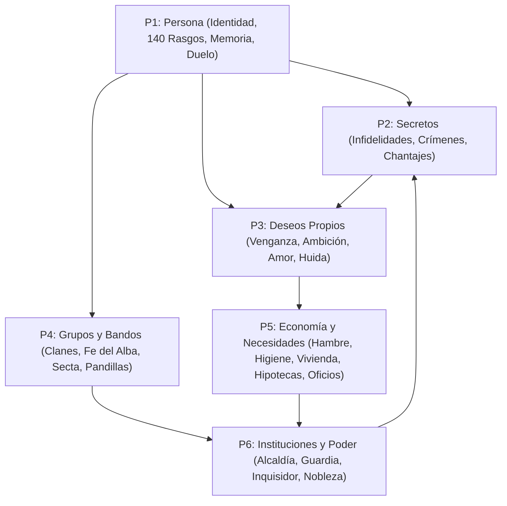

# Las 6 Piezas Maestras

> Sección original: *Las 6 Piezas Maestras de la Simulación (`VISION_Y_FUTURO`)*

- **[[Pieza 1 — Persona]]:** Identidad única (`person_id`), nombre y apellido heredable, edad y crecimiento, 6 rasgos de personalidad, memoria que se degrada, estado de ánimo, duelo por seres queridos y relaciones asimétricas de un solo sentido.
- **[[Pieza 2 — Secretos]]:** Separación estricta entre lo que ocurre y quién lo sabe (`known_by`), rumores que se deforman al contarse, infidelidades ocultas, crímenes sin testigos y chantajes.
- **[[Pieza 3 — Deseos Propios]]:** Metas a medio plazo que cada vecino persigue por su cuenta (vengarse, quedarse con un taller vacante, enamorar a alguien, encargar un sabotaje o planear un asesinato).
- **[[Pieza 4 — Grupos y Bandos]]:** Familias y [[Clanes Familiares]], pandillas de amigos, seguidores de un líder, devotos de la [[Fe del Alba]], cofradías de oficio, la [[Red de las Sombras]] y [[La Secta]] oculta.
- **[[Pieza 5 — Economía y Necesidades]]:** Bolsillo real, hambre, sueño, higiene, enfermedades contagiosas, clases sociales, hipotecas, alquileres, talleres con materias primas, [[Maestros Artesanos]] y [[Rutas Comerciales]].
- **[[Pieza 6 — Instituciones y Poder]]:** [[Alcaldía y Política]], elecciones en urna, impuestos de los sábados, decretos, [[Justicia y Comisaría]], [[Inquisidor Real Alistair]], [[Nobleza del Valle]] y [[Arcas Municipales]].
