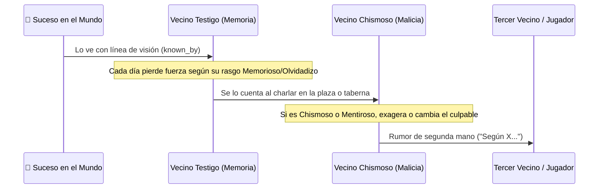

# Chismes, Memoria y Crónica

> Sección original: *Chismes, Memoria que se Deforma y Crónica (`C1–C5`, `R1–R5`, `B6`)*

- **Degradación de la Memoria (`R1–R3`):** Cada recuerdo tiene una intensidad que baja cada día según la tendencia `memory` del vecino (*Memorioso* lo retiene mucho más; *Olvidadizo* lo pierde rápido).
- **Teléfono Escacharrado (`R4–R5`):** Cuando un suceso pasa de boca en boca (`heard_from`), un vecino malicioso o chismoso puede **exagerar la gravedad** o incluso **atribuir el hecho al rival que peor le cae**.
- **Crónica del Pueblo (`[O]`):** Registra hasta 500 sucesos históricos filtrables por pestañas (*Todo, Amor, Amistad, Chismes, Peleas, Muertes, Fe, Llegadas, Tú*).

## Notas de diseño
-
