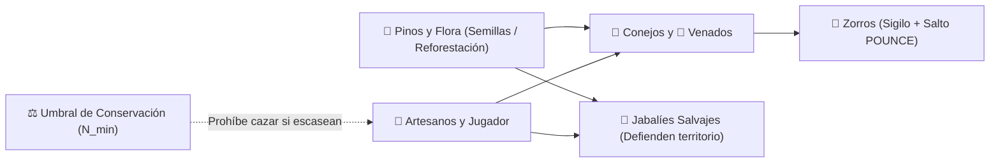

# Ecosistema del Bosque

> Sección original: *Ecosistema Salvaje del Bosque Profundo y Reforestación (`EcosystemManager`)*

- **3 Hábitats Separados:**
  1. **Pradera del Oeste:** Madrigueras de conejos y brotes de hierbas medicinales.
  2. **Claros del Centro-Sur:** Manadas de venados y círculos de hongos.
  3. **Cantera del Este y Guaridas:** Vetas de hierro, piedra y guaridas de zorros.
- **Piaras de Jabalíes y Ciénaga del Oeste:** Los jabalíes embisten cuando son heridos (los vecinos prudentes huyen si bajan del `50%` de vida). Al oeste, la **Llanura Salvaje y Ciénaga de Ranas** alberga ranas gigantes (ancas de rana) y campamentos de bandidos que se renuevan cada 2 días.
- **Equilibrio Matemático y Reforestación (`PJ.2`):**
  - Los recolectores del pueblo respetan un **umbral mínimo de conservación ($N_{\text{min}}$)** por especie para no extinguir el bosque.
  - El jugador puede **plantar semillas de pino** en el bosque (máximo 1 al día, hasta **12 pinos plantados** que se guardan y restauran al cargar partida). Cada pino plantado incrementa la recuperación de flora, fauna y la fertilidad de las granjas cercanas.

## Notas de diseño
-
