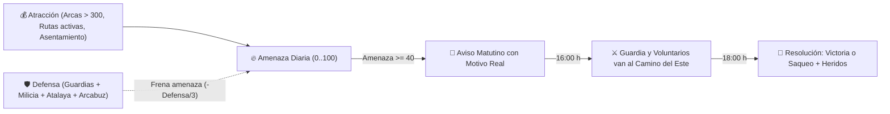

# Incursiones y Defensa

> Sección original: *Incursiones con Motivo Real y Defensa Física del Pueblo (`PL.1–PL.2`, `c456869`)*

- **Nada de Temporizadores Fijos:** Los asaltantes sólo se fijan en el valle si hay botín que robar (`raid_lure`: arcas municipales por encima de **300 de oro**, rutas comerciales activas o el asentamiento fronterizo).
- **Aviso Matutino:** Cuando la amenaza supera `40`, una mañana los exploradores avisan del ataque inminente explicando el **motivo real** (*«atraídos por el oro de las arcas»*, *«por las caravanas de Paso Alto»*, etc.).
- **Defensa Física a las 16:00 y Choque a las 18:00:** A las `16:00`, los guardias y hasta **3 vecinos voluntarios** con coraje/agresividad caminan físicamente hacia el **Camino del Este (`RAID_GATE_POS`)** con el encargo `raid_defend`. A las `18:00` se resuelve el combate: si el pueblo gana, la amenaza cae y sube el orgullo cívico; si pierde, los asaltantes saquean parte de las arcas y los defensores quedan heridos de verdad.

## Notas de diseño
-
